# Manual de Administración

## Qué hace Administración

Administración cuida el dinero de la empresa: hace las compras a los proveedores, paga lo que se debe, cobra a los clientes, lleva la caja chica y entrega los préstamos. También mantiene al día los precios (con la aprobación de Gerencia), los proveedores y los vehículos.

Administración **no recibe** la mercancía (eso lo hace Producción) y **no cambia** las reglas de pago ni los bonos (eso lo hace Gerencia). Lo que no puede cambiar, lo pide con «Pedir autorización».

## Mi día en 5 pasos

1. Entra al sistema y elige **Administración**.
2. Empieza por el **Resumen**: mira lo pendiente.
3. Haz las compras que hagan falta con **Nueva compra**.
4. Cobra lo que deben los clientes con **Cobranza** y paga a los proveedores en **Por pagar**.
5. Anota los gastos de caja chica y, al cierre, cuenta la caja con **Arqueo**.

---

## Cómo entro y elijo mi puesto

1. Abre el sistema.
2. Pulsa el botón **Administración**.
3. Se abre el **Resumen**.

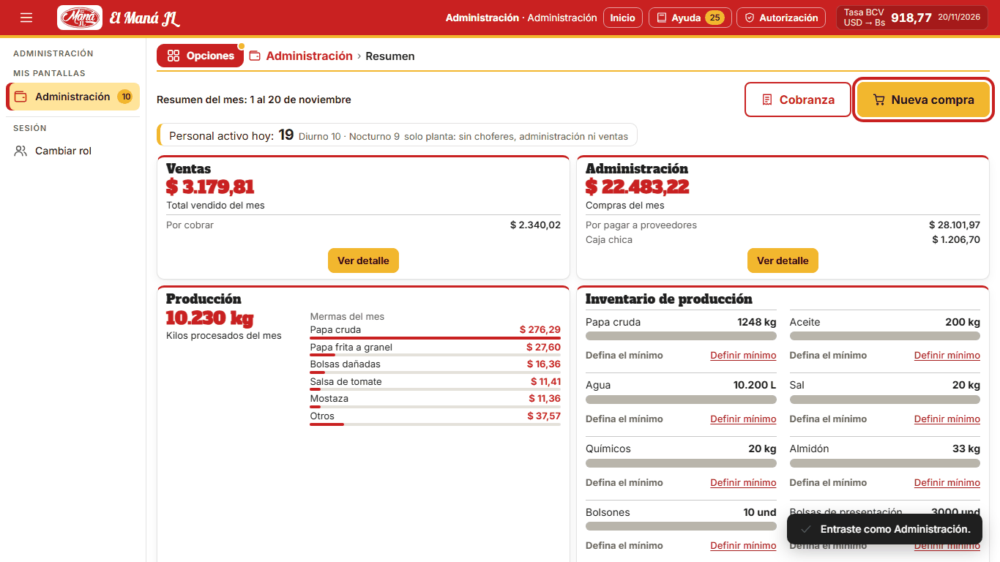

> Arriba del Resumen están los botones **Cobranza** y **Nueva compra**.

---

## Cómo hago una compra

1. En el Resumen, pulsa **Nueva compra** (o pulsa **Opciones**, elige **Compras** y abre **Hacer compra**).
2. En **Proveedor**, toca al proveedor (o pulsa **Nuevo proveedor**).
3. En **Productos**, pon la cantidad de cada producto con **+** y **−**.
4. Escribe el número de la factura del proveedor.
5. Escribe la fecha de la factura.

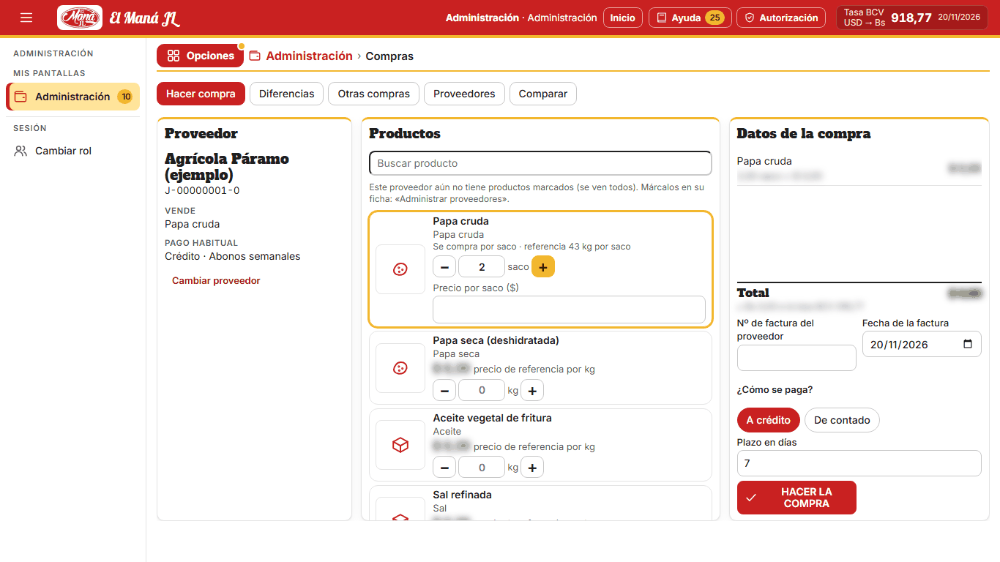

6. En **¿Cómo se paga?** elige el banco o la cuenta y el plazo en días.
7. Pulsa **HACER LA COMPRA**.

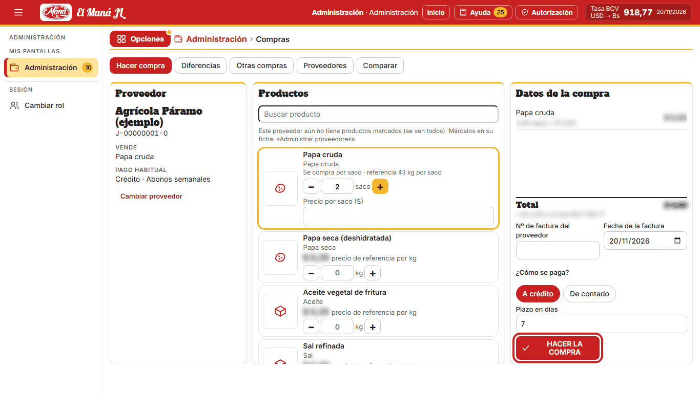

> La compra se hace en un solo paso: no hay que validarla después.
> Producción la ve en **Pedidas por recibir** y, cuando la recibe, queda lista.
> También se compran los **Bolsones** y las **Bolsas de presentación**.

---

## Cómo veo las diferencias de compras

1. Pulsa **Opciones** y elige **Compras**.
2. Abre la pestaña **Diferencias**.
3. Lee cada compra que llegó distinta a lo pedido y el motivo que escribió Producción.
4. Úsalo para reclamar al proveedor.
5. Marca cada una como vista.

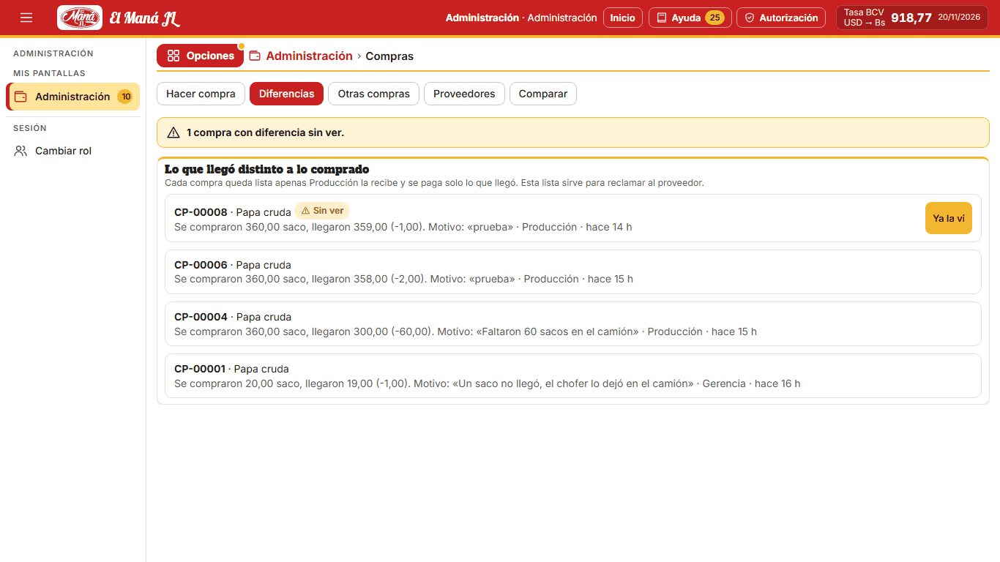

> Solo se paga lo que llegó.

---

## Cómo anoto otras compras

1. Pulsa **Opciones** y elige **Compras**.
2. Abre la pestaña **Otras compras**.
3. Escribe qué se compró.
4. Elige el proveedor.
5. Escribe el monto y elige la partida contable.
6. Escribe el **Motivo de la compra** (es obligatorio).
7. Pulsa **Registrar compra**.

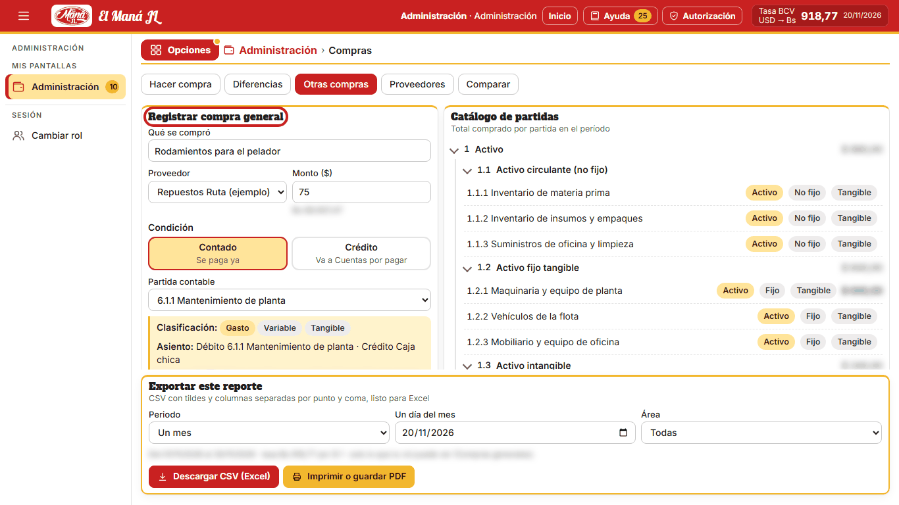

---

## Cómo pago a un proveedor

1. Pulsa **Opciones** y elige **Pagos y caja**.
2. Abre la pestaña **Por pagar**.
3. Busca la compra del proveedor.
4. Pulsa **Registrar pago** (o **Registrar abono** si pagas una parte).

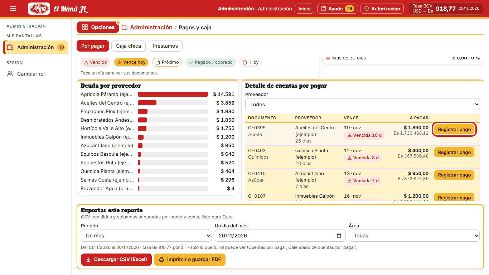

---

## Cómo cobro a un cliente

1. En el Resumen, pulsa **Cobranza** (o pulsa **Opciones**, elige **Cobranza** y abre **Registrar cobro**).
2. Paso 1: elige al cliente.
3. Paso 2: marca las notas y facturas que paga (o pulsa **Repartir el pago (más antigua primero)**).
4. Paso 3: escribe la fecha, el monto recibido (Bs), el banco y el número de referencia.
5. Pulsa **Registrar pago**.
6. Pulsa **Confirmar**.
7. Si quieres el comprobante, pulsa **Ver e imprimir el recibo**.

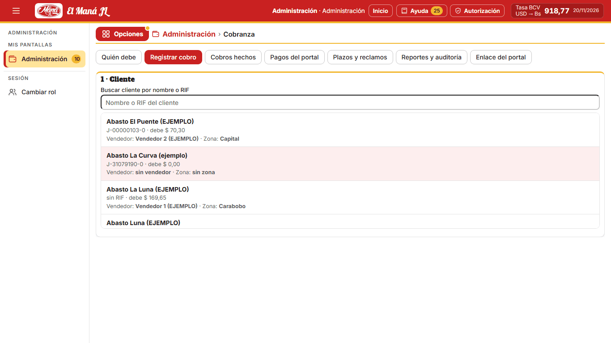

### Para ver a quién cobrar

1. Pulsa **Opciones** y elige **Cobranza**.
2. Abre la pestaña **Quién debe**.
3. Pulsa **WhatsApp**, **Llamar** o **Registrar cobro** en la fila del cliente.

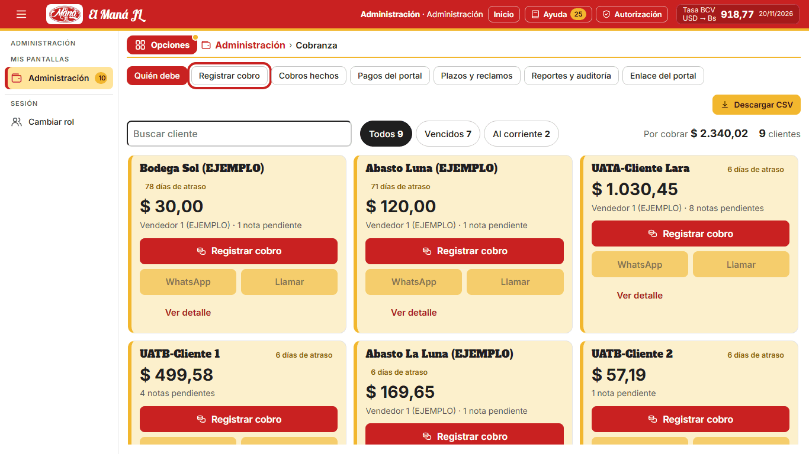

### Para revisar los pagos del portal del cliente

1. Pulsa **Opciones** y elige **Cobranza**.
2. Abre la pestaña **Pagos del portal**.
3. En cada pago pulsa **Confirmar y aplicar** o **Rechazar**.

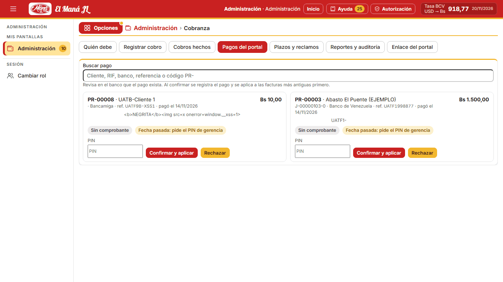

> Si la fecha del pago es anterior, el sistema pide el PIN de gerencia.

---

## Cómo anoto un gasto de caja chica

1. Pulsa **Opciones** y elige **Pagos y caja**.
2. Abre la pestaña **Caja chica**.
3. Baja hasta **Registrar gasto**.
4. Llena número, fecha, proveedor, RIF, monto, categoría y justificación.
5. Sube la foto del comprobante.
6. Pulsa **Guardar**.

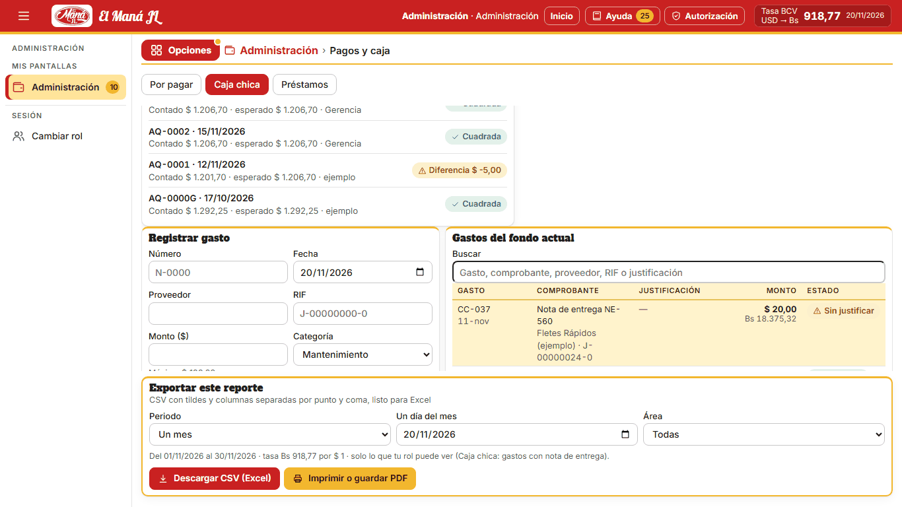

### Para contar la caja

1. En **Caja chica**, mira la tarjeta **Arqueo**.
2. Escribe el **Efectivo contado ahora ($)**.
3. Pulsa **Guardar arqueo**.

---

## Cómo entrego un préstamo

1. Pulsa **Opciones** y elige **Pagos y caja**.
2. Abre la pestaña **Préstamos**.
3. Elige al empleado.
4. Escribe monto, cuotas, fecha de entrega y motivo.
5. Pulsa **Entregar préstamo y generar recibo**.

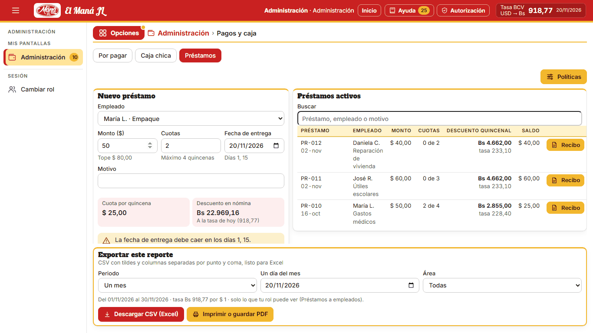

> La cuota se puede descontar después al pagar la nómina (lo hace Recursos humanos).

---

## Cómo pongo un precio

1. Pulsa **Opciones** y elige **Precios**.
2. Abre la pestaña **Por lista**.
3. Elige **Minorista**, **Mayorista** o **Gran Mayor**.
4. Toca el precio que quieres cambiar.
5. Si no hay precio, pulsa **Cargar precios** y escribe el de contado y el de crédito.

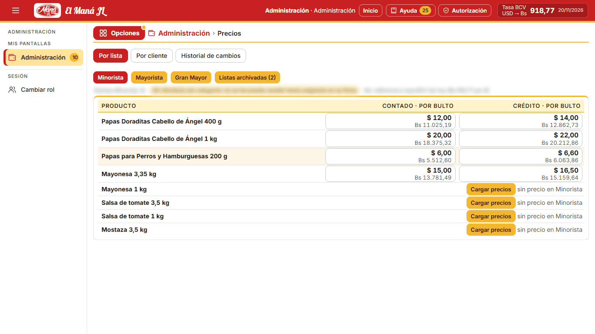

> Tu cambio se envía a Gerencia para que lo apruebe. Puedes ver cómo va en **Historial de cambios**.

---

## Cómo veo y defino el inventario mínimo

1. En el Resumen, mira la tarjeta **Inventario de producción**.
2. Cada insumo tiene una barra: verde si alcanza, amarillo si se acerca al mínimo, rojo si está en el mínimo o por debajo.
3. Pulsa **Definir mínimo** (o **Cambiar mínimo**) y escribe cuánto es lo mínimo.
4. Debajo de las barras, pulsa **Cargar** para anotar los **Kilos de papa por bolsón**.

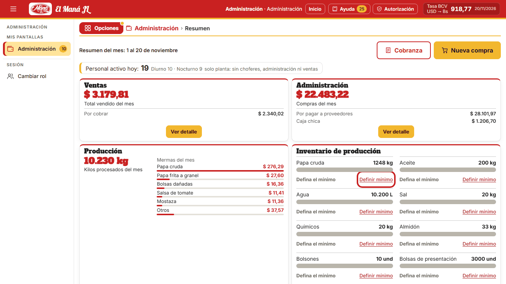

---

## Cómo registro a proveedores y vehículos

### Un proveedor

1. Pulsa **Opciones** y elige **Compras**.
2. Abre la pestaña **Proveedores**.
3. Pulsa **Nuevo proveedor**.
4. Escribe nombre, RIF, qué vende y condición de pago.
5. Pulsa **Guardar**.

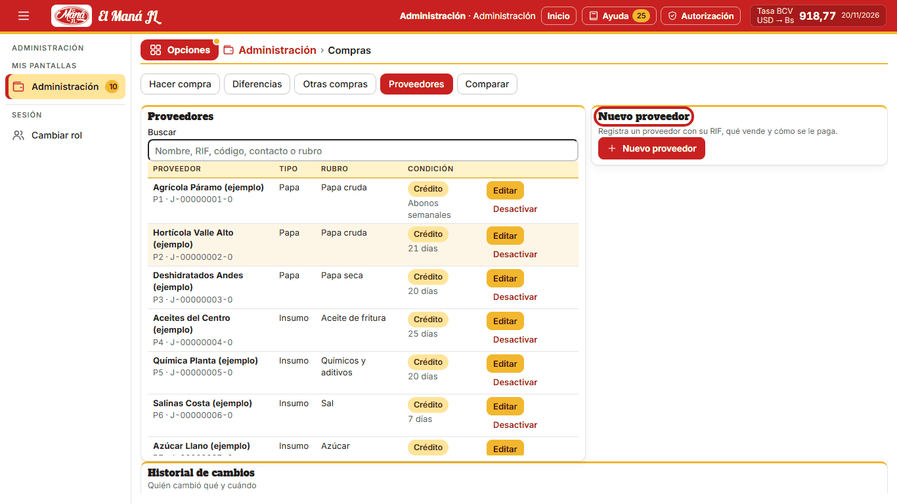

### Un vehículo

1. Pulsa **Opciones** y elige **Flota**.
2. Pulsa **Agregar vehículo**.
3. Escribe placa, tipo, marca, modelo, capacidades, estado, chofer habitual y cuándo vencen el seguro y los documentos.
4. Pulsa **Guardar**.

---

## Cómo veo los reportes, los bonos y las reglas

1. Pulsa **Opciones** y elige **Registro de ventas** para ver los **Reportes de ventas**.
2. Pulsa **Opciones** y elige **Bonos** para ver **Turno en vivo** y las metas.
3. Para las reglas de caja, entra en **Pagos y caja** y pulsa **Políticas** (arriba a la derecha).

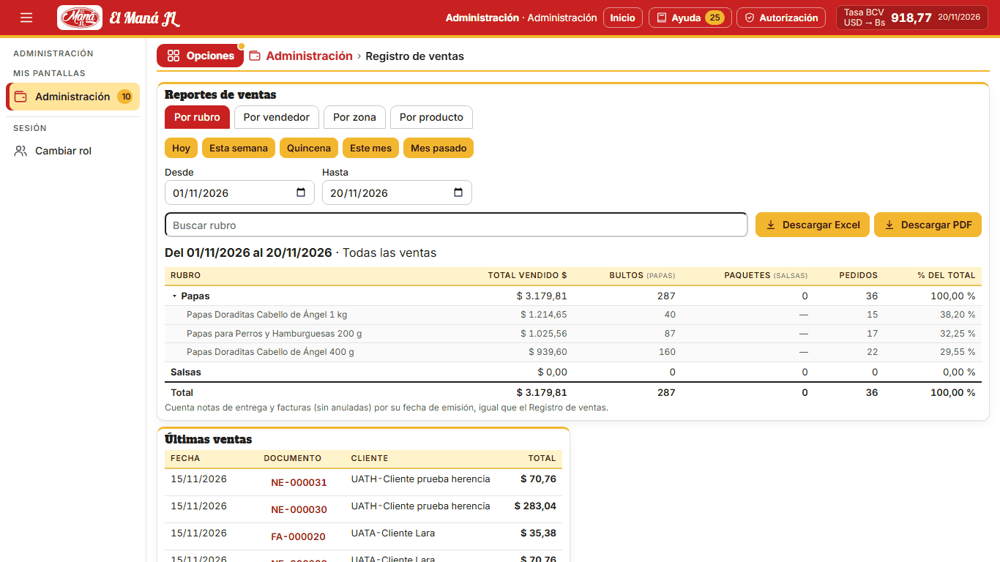

> Los parámetros de turnos y bonos solo los cambia Gerencia. Si hace falta un cambio, pulsa **Pedir autorización**.

---

## Si algo sale mal

### «Referencia repetida: no se guardó» al cobrar

1. Pulsa **Ver el pago existente**.
2. Revisa si ese pago ya estaba anotado.
3. Solo si no estaba, cámbiala y vuelve a intentar.

> Un pago con fecha pasada pide el **PIN de gerencia**. Pídelo a Gerencia.

### No puedo cambiar algo (por ejemplo un parámetro o una regla)

1. Pulsa **Autorización**, arriba.
2. Pulsa **Pedir autorización**.
3. En **¿Qué quieres cambiar?** elige lo que necesitas.
4. Escribe el **Motivo (obligatorio)**.
5. Pulsa **Enviar solicitud**.

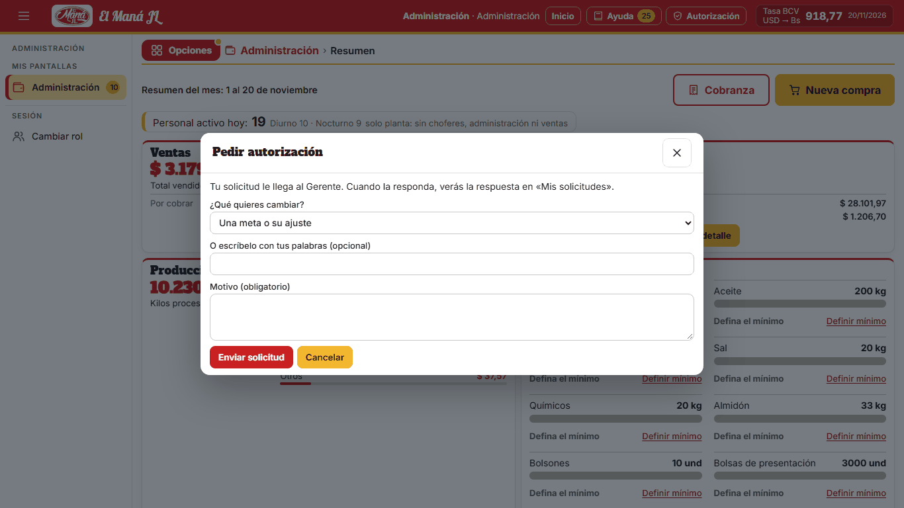

### Quiero saber qué respondieron

1. Abre **Mis solicitudes**.
2. Mira la respuesta de Gerencia.
