# Manual de Gerencia

## Qué hace Gerencia

Gerencia ve todo el negocio, aprueba lo que los demás puestos piden (precios, diferencias, pagos del portal, solicitudes), configura las reglas del sistema y revisa la auditoría. Es el único puesto que cambia las reglas de pago de nómina, los bonos y el PIN de gerencia.

Gerencia también puede entrar a las pantallas de los otros puestos. Para cada puesto hay un manual aparte.

## Mi día en 5 pasos

1. Entra al sistema y elige **Gerencia**.
2. Mira el **Resumen** y la tarjeta **Requiere atención**.
3. En **Por aprobar**, responde **Precios por aprobar**, **Solicitudes**, **Diferencias** y **Pagos del portal**.
4. Mira **Producción**, **Ventas** y **Administración** en el Resumen.
5. De vez en cuando, revisa la **Auditoría**.

---

## Cómo entro y elijo mi puesto

1. Abre el sistema.
2. Pulsa el botón **Gerencia**.
3. Se abre el **Resumen**.

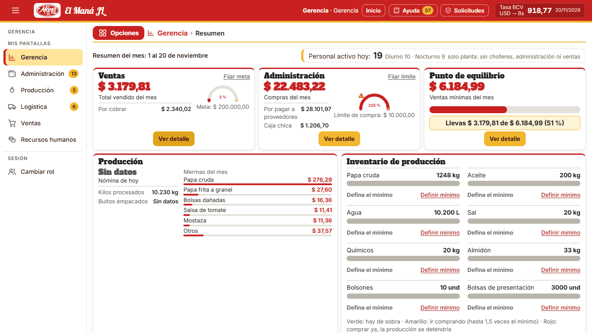

---

## Cómo apruebo los precios

1. Pulsa **Opciones**, elige **Por aprobar** y abre la pestaña **Precios**.
2. Revisa cada cambio.
3. Pulsa **Aprobar** o **Rechazar**.
4. Si quieres, escribe un motivo.

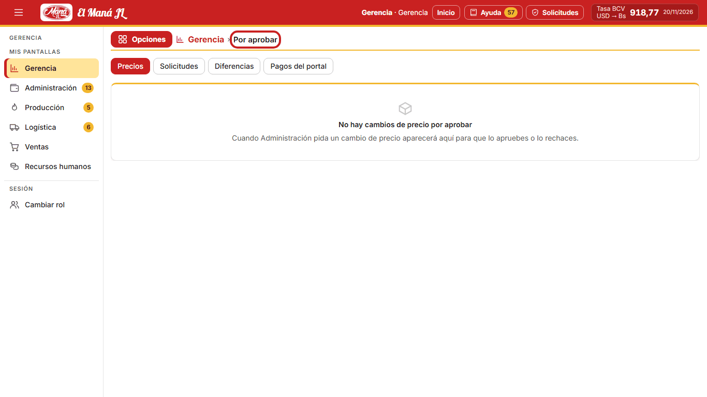

> Un precio nuevo solo vale cuando Gerencia lo aprueba.

---

## Cómo respondo las solicitudes de los puestos

1. Pulsa **Opciones**, elige **Por aprobar** y abre la pestaña **Solicitudes**.
2. En cada solicitud pulsa **Aprobar** (puedes dejar un comentario) o **Rechazar** (el motivo es obligatorio).

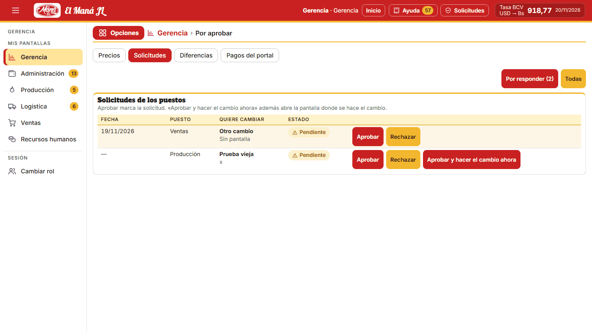

---

## Cómo resuelvo las diferencias y los pagos del portal

1. Pulsa **Opciones**, elige **Por aprobar** y abre la pestaña **Diferencias**.
2. Revisa cada diferencia y pulsa **Aprobar** o **Rechazar** (para rechazar, escribe el motivo).
3. Abre la pestaña **Pagos del portal**.
4. En cada pago pulsa **Confirmar y aplicar** o **Rechazar**.

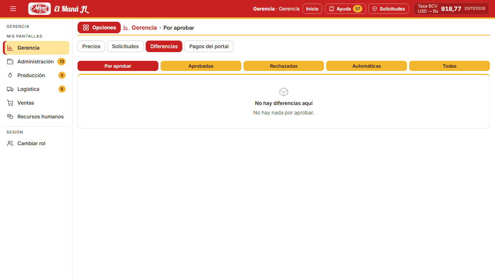

> Si la fecha del pago es anterior, el sistema pide el PIN de gerencia.

---

## Cómo configuro el sistema desde cero

### Los bancos

1. Pulsa **Opciones**, elige **Ajustes** y abre la pestaña **Bancos**.
2. Pulsa **Agregar banco**.
3. Escribe el nombre del banco, la moneda, el número de cuenta y el titular.
4. Escribe también el teléfono (Pago Móvil), la cédula y el RIF.
5. Pulsa **Guardar**.

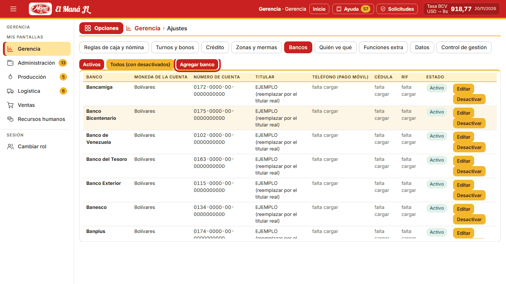

> La tasa del dólar no se escribe: se lee sola del BCV.

### Los horarios, las reglas de pago y el bono

1. Pulsa **Opciones**, elige **Ajustes** y abre la pestaña **Turnos y bonos**.
2. En **Horario por turno**, pon cuándo entran y salen el Diurno y el Nocturno.
3. En **Reglas de pago de nómina**, pon la jornada completa, el recargo de hora extra (%) y las deducciones de ley (%).
4. En **Bono de producción**, elige **Por kilo** o **Monto fijo** y la meta de kilos por turno.
5. Pulsa **Guardar parámetros**.

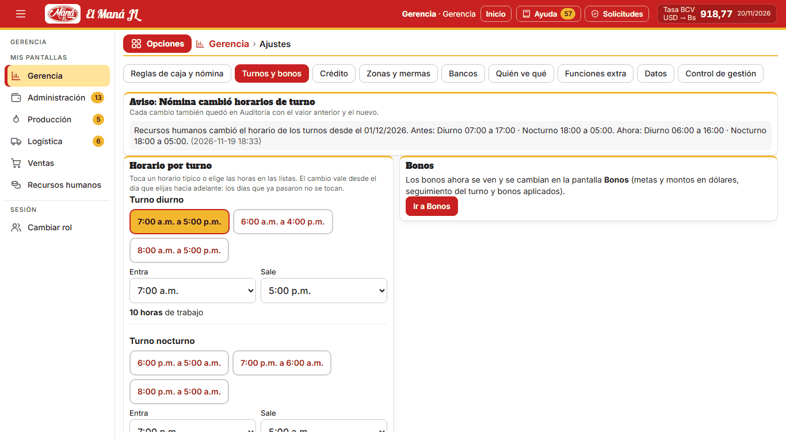

### El PIN de gerencia

1. Pulsa **Opciones**, elige **Ventas**, **Clientes y catálogo** y abre la pestaña **Ajustes**.
2. En **PIN de gerencia**, escribe el PIN (de 4 a 12 números) y pulsa **Crear PIN** (si ya hay uno, el botón dice **Cambiar PIN**).
3. Si quieres, llena el **Membrete de los documentos** y pulsa **Guardar ajustes**.

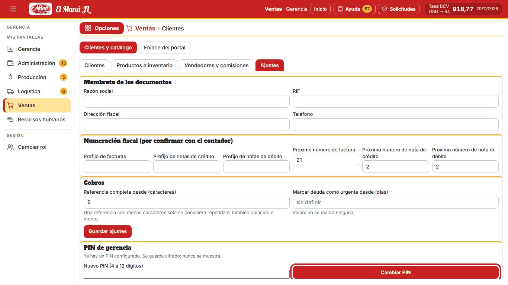

> El PIN se pide para anotar un pago con fecha pasada y para perdonar mora.

### Las reglas de caja y nómina

1. Pulsa **Opciones**, elige **Ajustes** y abre la pestaña **Reglas de caja y nómina**.
2. Revisa el **Fondo fijo ($)**, el **Umbral de compra de contado ($)**, **Reponer cuando quede menos de (%)** y la **Tolerancia de peso en recepción (%)**.
3. Revisa los préstamos: días de entrega, tope por empleado ($) y cuotas máximas.
4. Pulsa **Guardar políticas**.

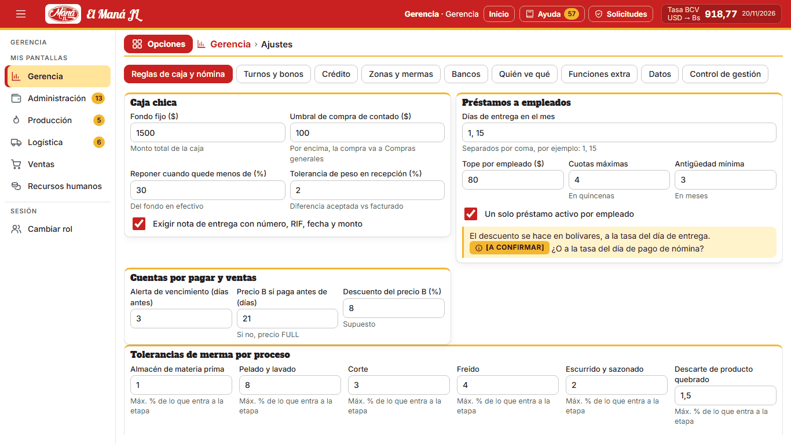

---

## Cómo cargo la información base

1. **Productos**: en **Ventas**, **Clientes y catálogo**, abre **Productos e inventario** y pulsa **Producto nuevo**. Escribe SKU, nombre, gramaje, categoría (**Papas** o **Salsas**) e IVA (%) y pulsa **Guardar**.
2. **Clientes**: en **Ventas**, **Clientes y catálogo**, pestaña **Clientes**, pulsa **Cliente nuevo**.
3. **Personas**: entra como Recursos humanos, abre **Personas** y pulsa **Agregar persona**.
4. **Proveedores**: en **Administración**, **Compras**, abre **Proveedores** y pulsa **Nuevo proveedor**.
5. **Vehículos**: en **Administración**, abre **Flota** y pulsa **Agregar vehículo**.
6. **Conteo inicial de producto terminado**: pulsa **Cargar el conteo inicial**, llena el conteo y pulsa **Guardar el conteo**. Solo se hace una vez.

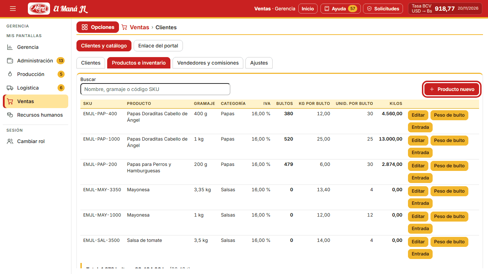

---

## Cómo defino los mínimos de inventario

1. En el **Resumen**, mira la tarjeta **Inventario de producción**.
2. Pulsa **Definir mínimo** (o **Cambiar mínimo**) en cada insumo.
3. Escribe cuánto es lo mínimo.
4. Pulsa **Cargar** para los **Kilos de papa por bolsón**.

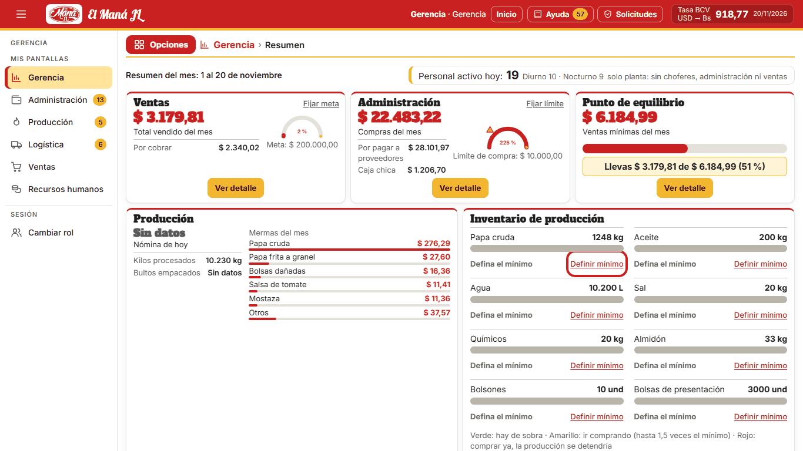

---

## Cómo reviso la auditoría y los reportes

1. Pulsa **Opciones** y elige **Auditoría**.
2. Consulta lo que se hizo en el sistema. Solo se mira: no se puede cambiar.
3. Si quieres guardarla, pulsa **Descargar CSV**.
4. Pulsa **Opciones** y elige **Reportes** para ver los **Cambios en existencias** y las **Solicitudes de compra**.

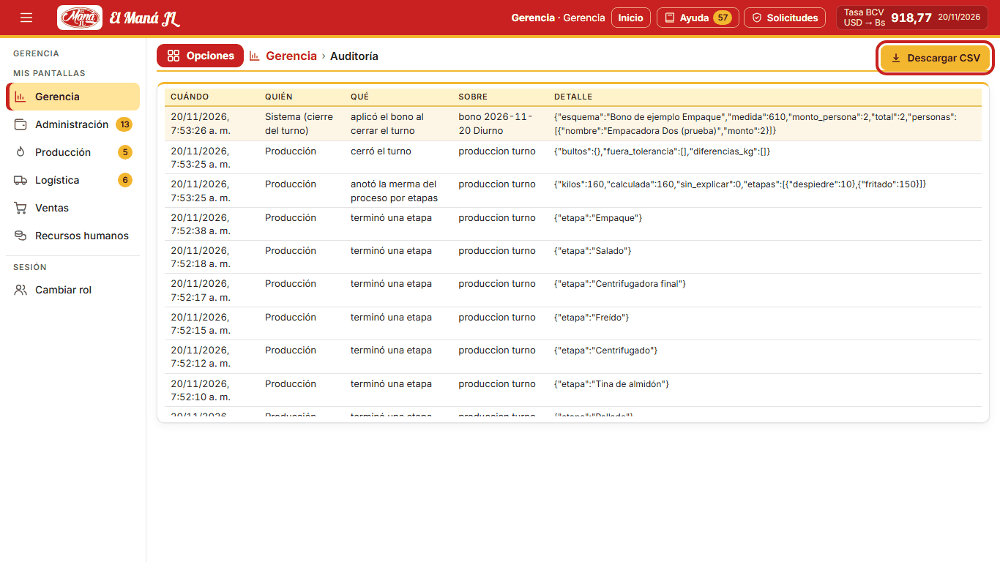

---

## Cómo decido quién ve qué

1. Pulsa **Opciones**, elige **Ajustes** y abre la pestaña **Quién ve qué**.
2. Revisa qué puede abrir cada puesto.
3. En la pestaña **Funciones extra** puedes darle a un puesto una función más.

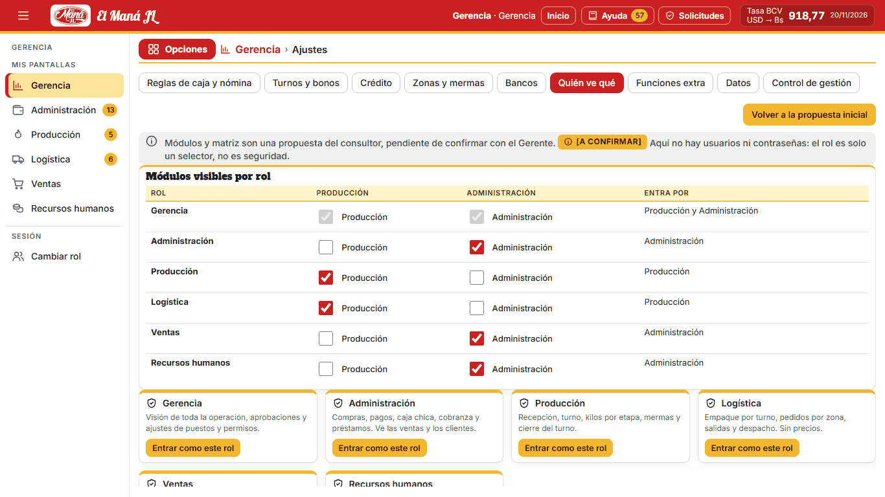

---

## Los manuales de los demás puestos

Para ver cómo trabaja cada puesto, abre **Ayuda** y entra en la pestaña de manuales. Ahí están los seis manuales: Gerencia, Administración, Producción, Logística, Ventas y Recursos humanos.

---

## Si algo sale mal

### Anulé un cobro mal puesto

1. Entra en **Administración**, **Cobranza**, pestaña **Cobros hechos**, y pulsa **Anular** en la fila.
2. Escribe el **Motivo de la anulación**.
3. El cobro no se borra: queda marcado como anulado.

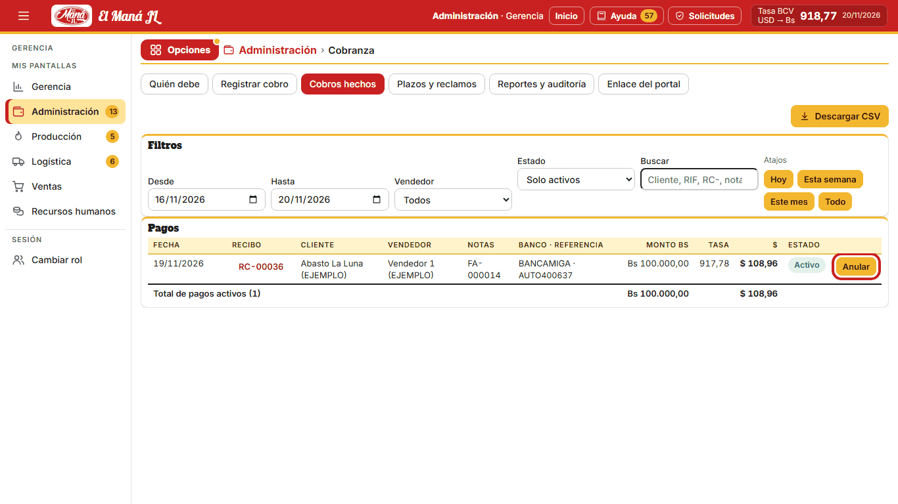

### Corregir la merma de un turno ya cerrado

1. Solo Gerencia puede hacerlo, con una nota.
2. Revisa el Resumen de Producción: la diferencia aparece como «Sin explicar».

### Un puesto pide algo que no puede cambiar

1. Aparece en **Solicitudes** (en **Por aprobar**).
2. Pulsa **Aprobar** o **Rechazar**.

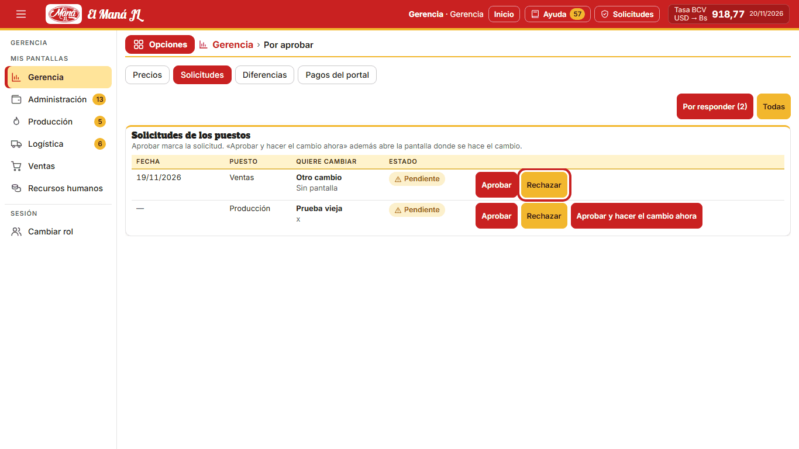

### Falta el motivo de merma «Agua evaporada»

1. Pulsa **Opciones**, elige **Ajustes** y abre la pestaña **Zonas y mermas** (o **Motivos de merma**).
2. Agrega el motivo.
