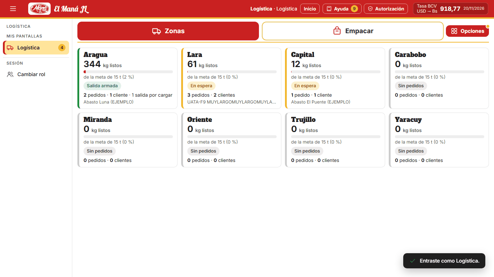
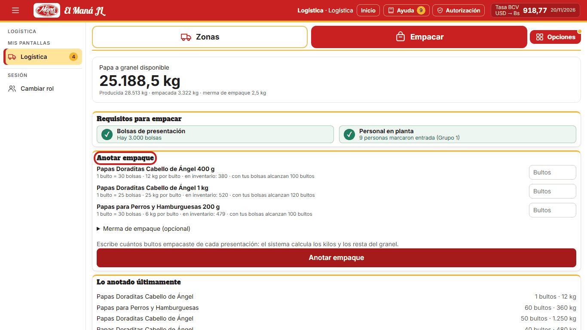
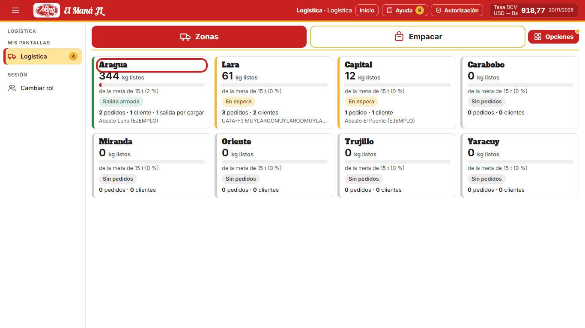
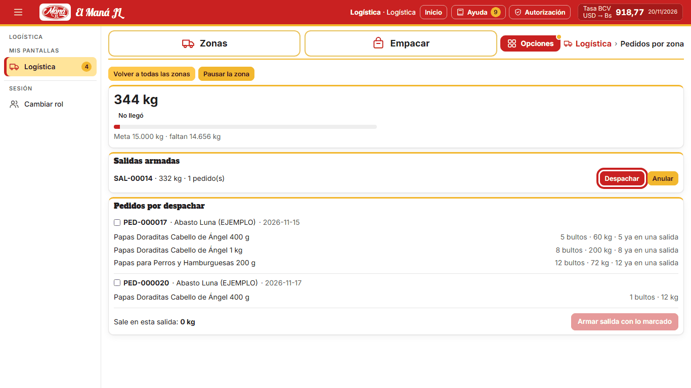
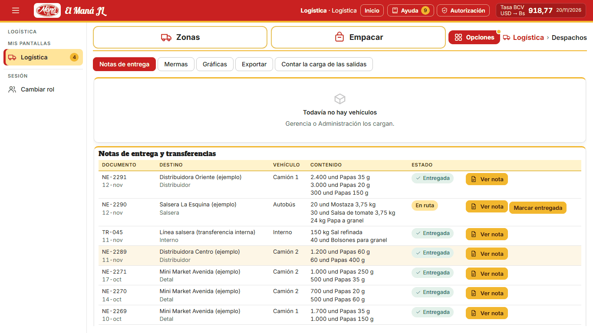
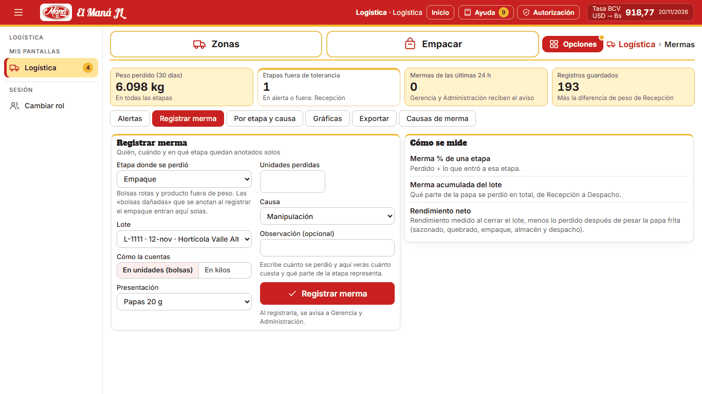
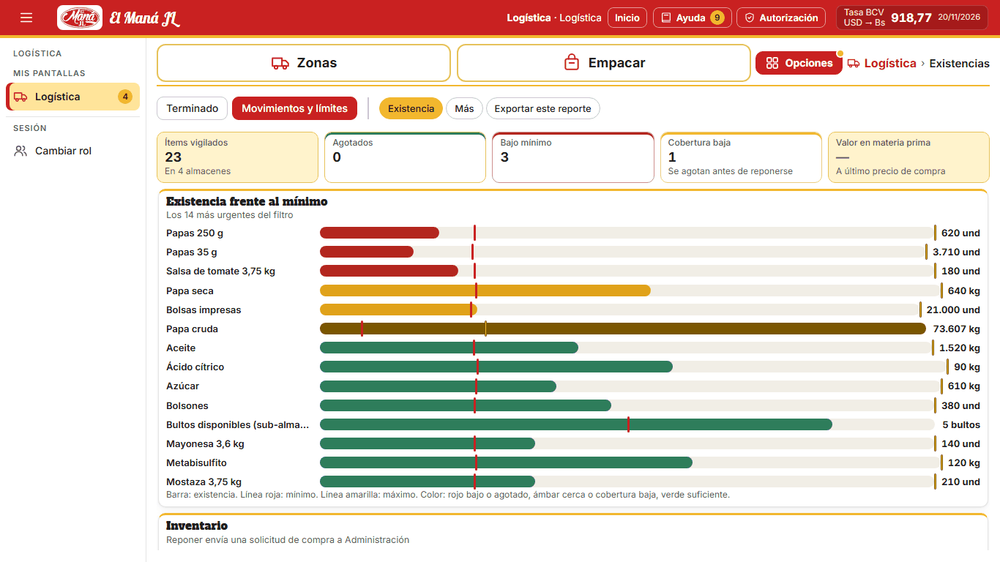
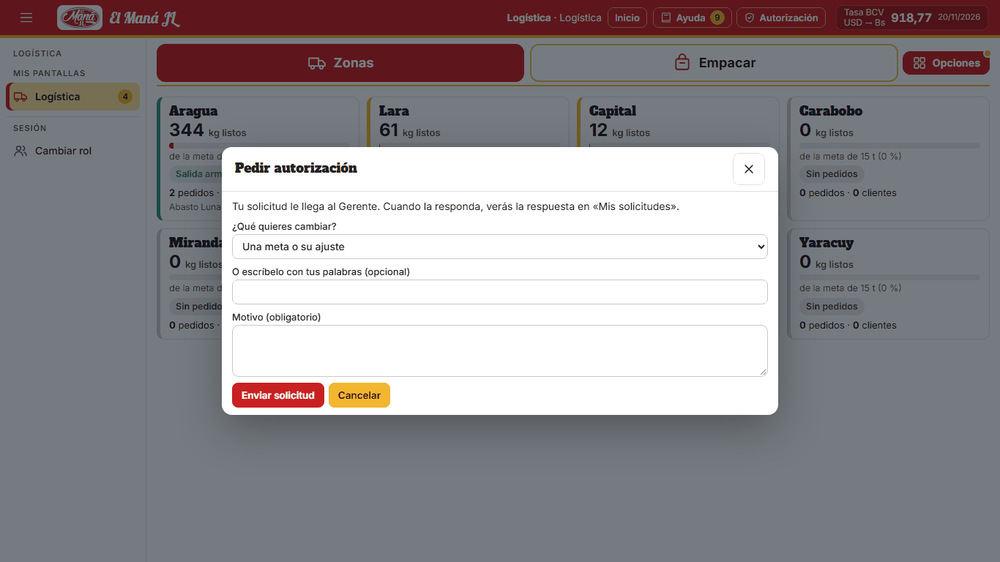

# Manual de Logística

## Qué hace Logística

Logística empaca la papa terminada, arma las salidas por zona, despacha con vehículo y chofer, cuenta la carga y marca las entregas. Si se pierde algo al empacar, anota la merma.

Logística **no ve precios ni costos**.

## Mi día en 5 pasos

1. Entra al sistema y elige **Logística**.
2. En **Empacar**, mira los requisitos y anota lo empacado.
3. En **Zonas**, mira los pedidos del día.
4. Arma la salida y despacha.
5. Cuenta la carga, marca **en ruta** y marca **entregada**.

---

## Cómo entro y elijo mi puesto

1. Abre el sistema.
2. Pulsa el botón **Logística**.
3. Se abre **Zonas**.

---

## Cómo anoto lo empacado

1. Pulsa el botón grande **Empacar**.
2. Mira **Papa a granel disponible**.
3. Mira **Requisitos para empacar**: **Bolsas de presentación** y **Personal en planta** deben salir en verde.
4. En **Anotar empaque**, escribe los **Bultos** de cada presentación.
5. Si hubo pérdida, abre **Merma de empaque (opcional)** y escribe los kilos y el motivo.
6. Pulsa **Anotar empaque**.

> No hace falta un turno abierto.
> El sistema calcula los kilos, descuenta las bolsas y suma al inventario: Ventas puede vender enseguida.
> No te deja pasar de lo disponible.

---

## Cómo miro las zonas del día

1. Pulsa el botón grande **Zonas**.
2. Cada tarjeta es una zona (Aragua, Lara, Capital...) y muestra los kilos listos y los pedidos.
3. Toca la tarjeta de una zona para abrirla.

> Es el punto de partida de Logística.

---

## Cómo armo y despacho una zona

1. Pulsa **Zonas** y toca la tarjeta de la zona.
2. En **Pedidos por despachar**, marca los pedidos que salen.
3. Pulsa **Armar salida con lo marcado**.
4. La salida aparece en **Salidas armadas**.
5. Si quedas por debajo de la meta o partes un pedido, escribe el motivo.
6. Pulsa **Despachar** en la salida.
7. Elige el vehículo y el chofer.

> **Pausar la zona** pide un motivo. Al despachar se emiten las notas de entrega o facturas.

---

## Cómo cuento la carga y marco la entrega

1. Pulsa **Opciones** y elige **Despachos**.
2. Abre la pestaña **Contar la carga de las salidas**.
3. Cuenta la carga y pulsa **Guardar la carga**.
4. Pulsa **Marcar en ruta** al salir.
5. Pulsa **Marcar entregada** al llegar.

> En **Notas de entrega**, **Ver nota** abre la nota. Si aún no hay vehículos, Gerencia o Administración los cargan.

---

## Cómo anoto una merma

1. Pulsa **Opciones** y elige **Mermas**.
2. Abre la pestaña **Registrar merma**.
3. Elige la **Etapa donde se perdió** y el **Lote**.
4. Elige cómo cuentas: **En unidades (bolsas)** o **En kilos**.
5. Escribe las **Unidades perdidas** y elige la **Causa**.
6. Pulsa **Registrar merma**.

---

## Cómo veo el inventario disponible

1. Pulsa **Opciones** y elige **Existencias**.
2. Abre **Movimientos y límites**.
3. Mira la barra de cada producto: verde si alcanza, amarillo si se acerca al mínimo, rojo si está por debajo.

> Logística solo lo mira.

---

## Si algo sale mal

### El botón «Anotar empaque» está apagado

1. Mira qué requisito sale en rojo.
2. Si faltan bolsas de presentación: pide a Administración que compre.
3. Si falta personal: pide a Recursos humanos que marque la asistencia.
4. Cuando esté en verde, pulsa **Anotar empaque**.

### Armé una salida equivocada

1. En la zona, busca la salida en **Salidas armadas**.
2. Pulsa **Anular**.
3. Escribe un motivo corto (al menos 3 letras).

> La salida queda anulada, no borrada.

### Necesito algo que no puedo cambiar

1. Pulsa **Autorización**, arriba.
2. Pulsa **Pedir autorización**.
3. En **¿Qué quieres cambiar?** elige lo que necesitas.
4. Escribe el **Motivo (obligatorio)**.
5. Pulsa **Enviar solicitud**.

### Quiero saber qué respondieron

1. Abre **Mis solicitudes**.
2. Mira la respuesta de Gerencia.
