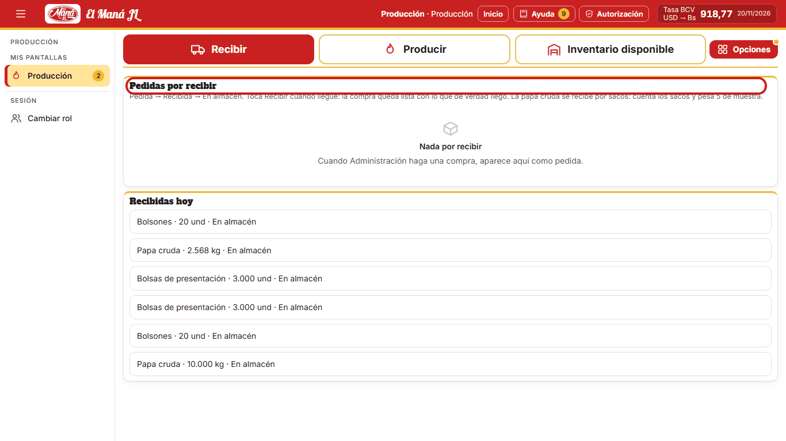
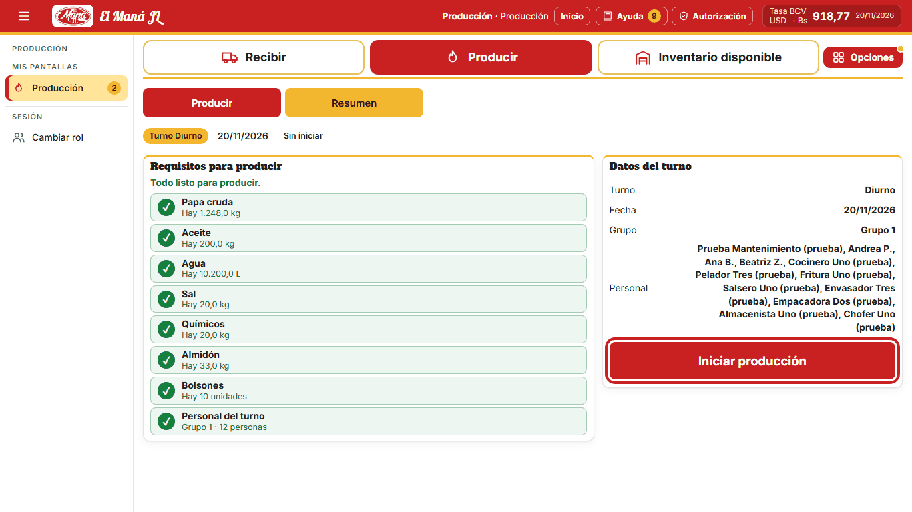
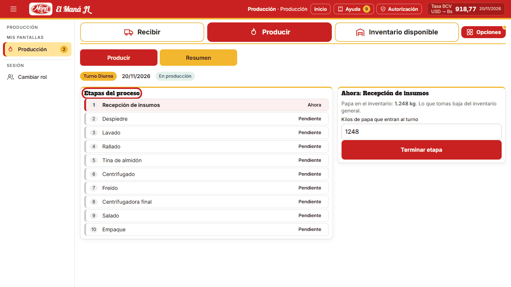
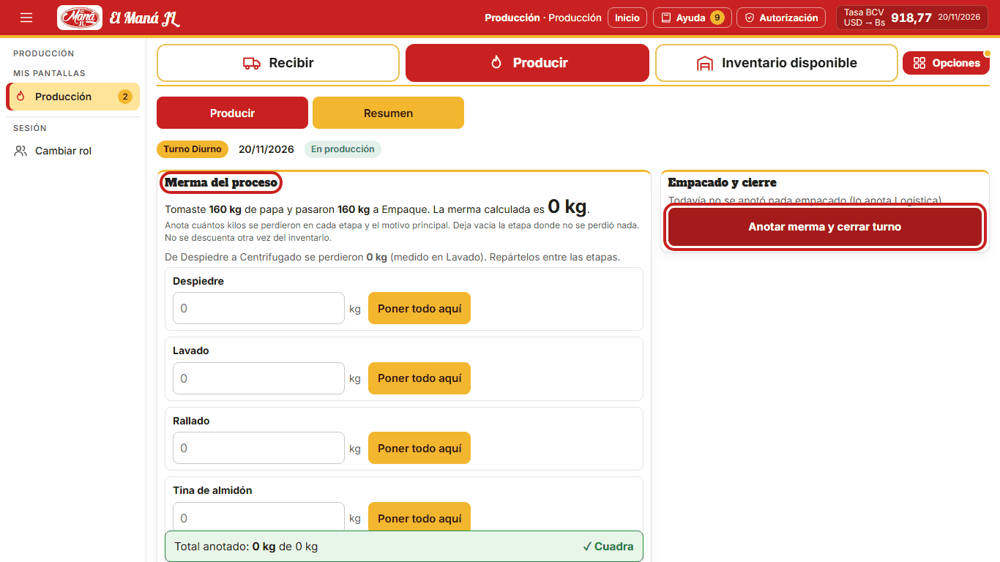
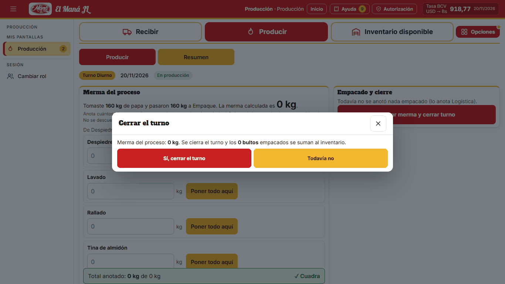
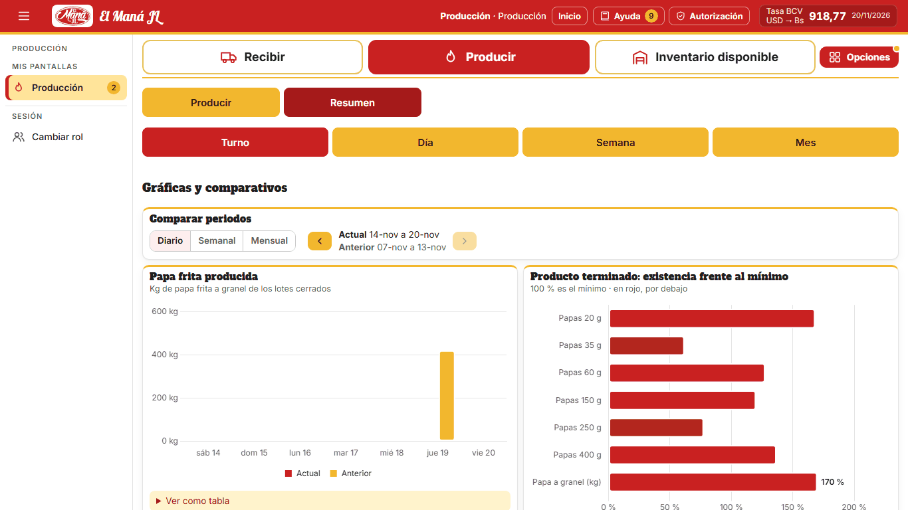
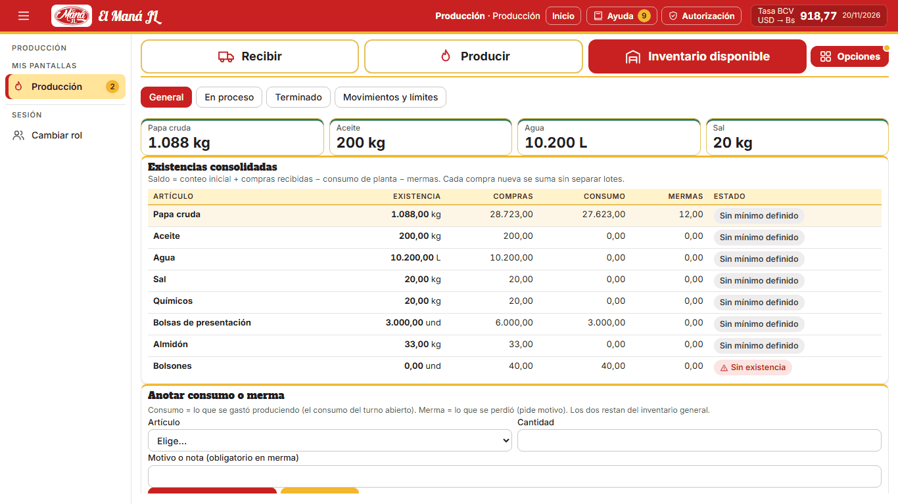
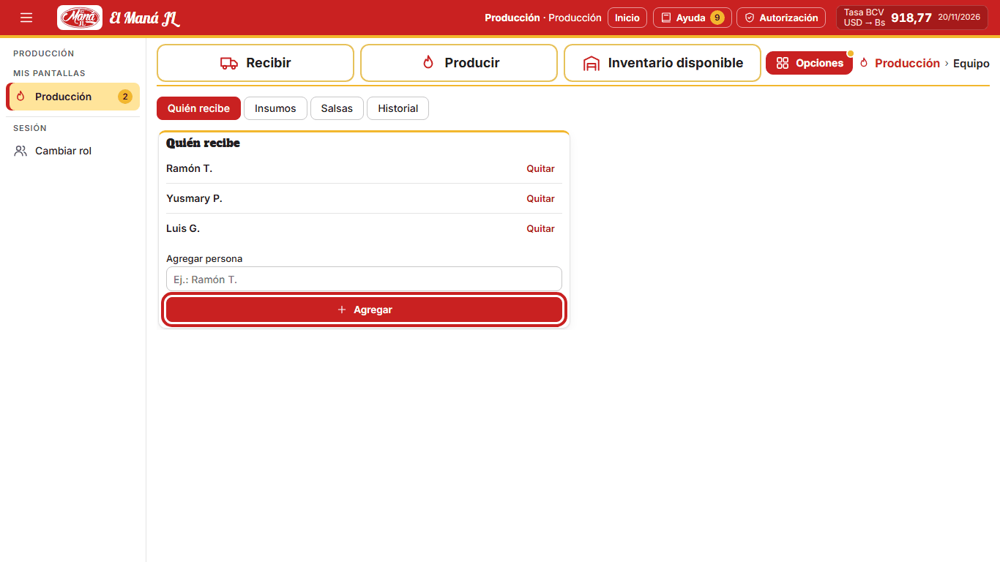
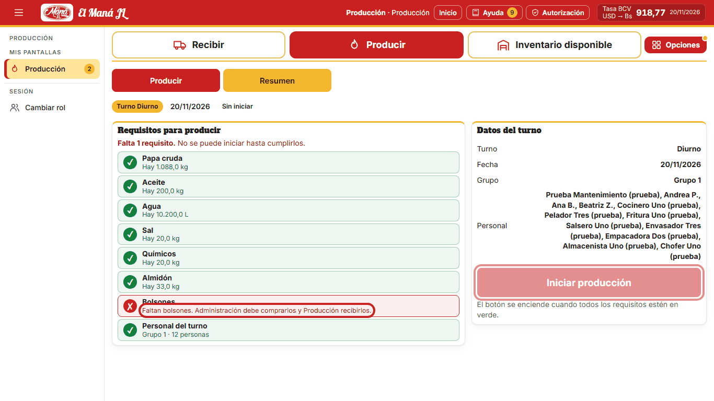
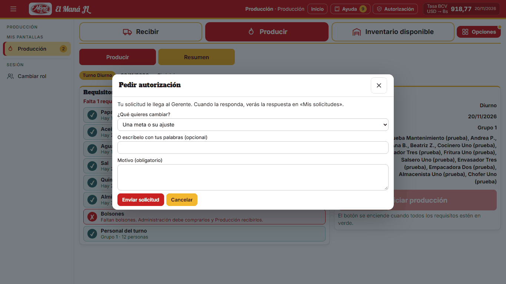

# Manual de Producción

## Qué hace Producción

Producción recibe lo que llega (papa, insumos, bolsones), revisa que haya todo lo necesario, inicia el turno, hace las etapas de la producción en orden, anota la merma de cada etapa y cierra el turno. Lo empacado lo anota Logística.

Producción **no ve precios ni costos**. Las compras las hace Administración.

## Mi día en 5 pasos

1. Entra al sistema y elige **Producción**.
2. En **Recibir**, recibe lo que llegó (**Pedidas por recibir**).
3. En **Producir**, mira que los requisitos estén en verde y pulsa **Iniciar producción**.
4. Haz las etapas una a una y pulsa **Terminar etapa**.
5. Al final anota la merma y pulsa **Anotar merma y cerrar turno**.

---

## Cómo entro y elijo mi puesto

1. Abre el sistema.
2. Pulsa el botón **Producción**.
3. Se abre la pantalla **Producir**. Arriba tienes tres botones grandes: **Recibir**, **Producir** e **Inventario disponible**.

---

## Cómo recibo lo que llegó

1. Pulsa el botón grande **Recibir**.
2. Arriba, en **Pedidas por recibir**, busca la compra que llegó.
3. Pulsa **Recibir** en esa compra.
4. Escribe lo que llegó de cada producto.
5. Si llegó distinto a lo pedido, el sistema te avisa: confirma y escribe el motivo.
6. Pulsa el botón para guardar la recepción.

> La papa llega por sacos: cuenta los sacos y pesa los de muestra que pide la pantalla.
> Los **Bolsones** y las **Bolsas de presentación** se reciben igual que cualquier compra.
> Más abajo ves solo lo recibido hoy.
> Elige **Quién recibe**. Si no hay nadie, agrégalo en «Cómo agrego a quien recibe».

---

## Cómo inicio el turno

1. Pulsa el botón grande **Producir** (pestaña **Producir**).
2. Mira los requisitos: papa, aceite, agua, sal, químicos, almidón, **Bolsones** y el personal del turno.
3. Cada uno sale en verde con «Hay …» si alcanza.
4. Si todos están en verde, pulsa **Iniciar producción**.

> El turno nace al pulsar **Iniciar producción** (Diurno o Nocturno, según la hora). Mirar la pantalla no lo crea.
> Los bolsones son las bolsas grandes donde va la papa a granel.
> Si no hay papa recibida pero el inventario general tiene, se descuenta de ahí.

---

## Cómo hago las etapas

1. En **Etapas del proceso**, mira la que dice **Ahora** (se hacen una a una, en orden): Recepción de insumos, Despiedre, Lavado, Rallado, Tina de almidón, Centrifugado, Freído, Centrifugadora final, Salado y Empaque.
2. En la primera, escribe los **Kilos de papa que entran al turno**.
3. Pulsa **Terminar etapa**.
4. Repite con cada etapa. Cuando la etapa esté lista, pulsa **Terminar etapa** otra vez.

---

## Cómo marco quién fríe

1. En la etapa **Freído**, pulsa **¿Quién fríe en este turno?**.
2. Elige a la persona.
3. Pulsa **Marcar**.

> Cada persona marcada gana el Bono Fritura de su jornada. Si te equivocas, pulsa **Quitar**.

---

## Cómo anoto la merma y cierro el turno

1. Cuando todo pasó a Empaque, el sistema muestra **Merma del proceso** y calcula la merma.
2. Verás una fila por etapa (Despiedre, Lavado, Rallado, Tina de almidón, Centrifugado, Freído, Centrifugadora final y Salado). En cada etapa donde se perdió papa, escribe los kilos.
3. Toca el motivo principal: **Cáscara**, **Tierra**, **Aceite**, **Derrame** u **Otra** (con **Otra** escribe qué fue).
4. Deja vacía la etapa sin pérdida. **Poner todo aquí** llena lo que falta del tramo.
5. Mira el total en vivo.
6. Si el total no cuadra, escribe por qué.
7. Pulsa **Anotar merma y cerrar turno**.

8. Aparece **Cerrar el turno**. Pulsa **Sí, cerrar el turno** (o **Todavía no** para volver).

> Es una sola vez por turno. La diferencia que no se explica queda como «Sin explicar».
> Antes de cerrar la puedes corregir con **Corregir**. Ya cerrado el turno, solo Gerencia la corrige.

---

## Cómo veo el resumen del turno

1. En **Producir**, abre la pestaña **Resumen**.
2. Elige **Turno**, **Día**, **Semana** o **Mes**.
3. Mira el bloque **Avisos**: lo que requiere atención.

---

## Cómo veo el inventario disponible

1. Pulsa el botón grande **Inventario disponible**.
2. Mira la barra de cada insumo: verde si alcanza, amarillo si se acerca al mínimo, rojo si está en el mínimo o por debajo.
3. Entre los insumos están **Bolsones** y **Bolsas de presentación**.

> Producción solo lo mira. El mínimo lo define Gerencia o Administración.

---

## Cómo agrego a quien recibe

1. Pulsa **Opciones** y elige **Equipo**.
2. En la tarjeta **Quién recibe**, escribe el nombre en **Agregar persona**.
3. Pulsa **Agregar**.

---

## Si algo sale mal

### El botón «Iniciar producción» está apagado

Es porque falta algún requisito o no hay personal marcado.

1. Mira cuál requisito sale en rojo.
2. Si falta un insumo o los **Bolsones** (sale «Faltan bolsones. Administración debe comprarlos y Producción recibirlos»): avisa a Administración para que compre. Cuando llegue, recíbelo en **Recibir**.
3. Si falta personal: avisa a Recursos humanos para que arme el grupo y marque la entrada.
4. Cuando todo esté en verde, pulsa **Iniciar producción**.

> Ni Gerencia puede saltarse el requisito de bolsones.

### La compra llegó distinta a lo pedido

1. En **Recibir**, escribe lo que de verdad llegó.
2. Confirma el aviso y escribe el motivo.

### No me cuadra la merma

1. Escribe en cada etapa lo que pasó.
2. Si el total sigue sin cuadrar, escribe por qué en la nota.
3. Pulsa **Anotar merma y cerrar turno**: la diferencia queda como «Sin explicar».

### Necesito algo que no puedo cambiar

1. Pulsa **Autorización**, arriba.
2. Pulsa **Pedir autorización**.
3. En **¿Qué quieres cambiar?** elige lo que necesitas.
4. Escribe el **Motivo (obligatorio)**.
5. Pulsa **Enviar solicitud**.

### Quiero saber qué respondieron

1. Abre **Mis solicitudes**.
2. Mira la respuesta de Gerencia.
