# Manual de Recursos humanos

## Qué hace Recursos humanos

Recursos humanos cuida a las personas de la empresa: marca quién entra y quién sale, arma los grupos de turno, agrega al personal, importa las marcas del lector de huellas, revisa la asistencia y paga la nómina.

Recursos humanos **no cambia** las reglas de pago ni los bonos: eso es de Gerencia. Sí puede cambiar los horarios de los turnos.

## Mi día en 5 pasos

1. Entra al sistema y elige **Recursos humanos**.
2. En **En planta hoy**, marca la entrada de cada persona (o de todo el grupo).
3. Al final del turno, marca la salida.
4. Mira **Asistencia** y **Bonos** para ver que todo cuadre.
5. En fechas de pago, entra en **Pagar nómina**.

---

## Cómo entro y elijo mi puesto

1. Abre el sistema.
2. Pulsa el botón **Recursos humanos**.
3. Se abre **En planta hoy**.

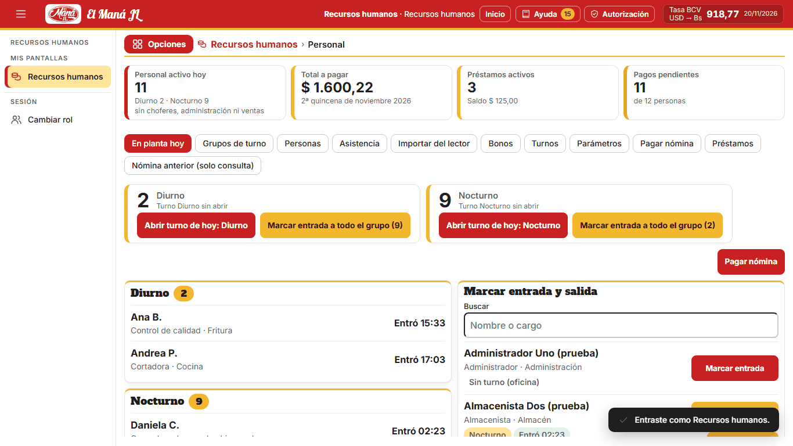

---

## Cómo marco la entrada y la salida

1. Entra en **En planta hoy**.
2. En **Marcar entrada y salida**, busca a la persona.
3. Pulsa **Marcar entrada** cuando llega.
4. Pulsa **Marcar salida** cuando se va.

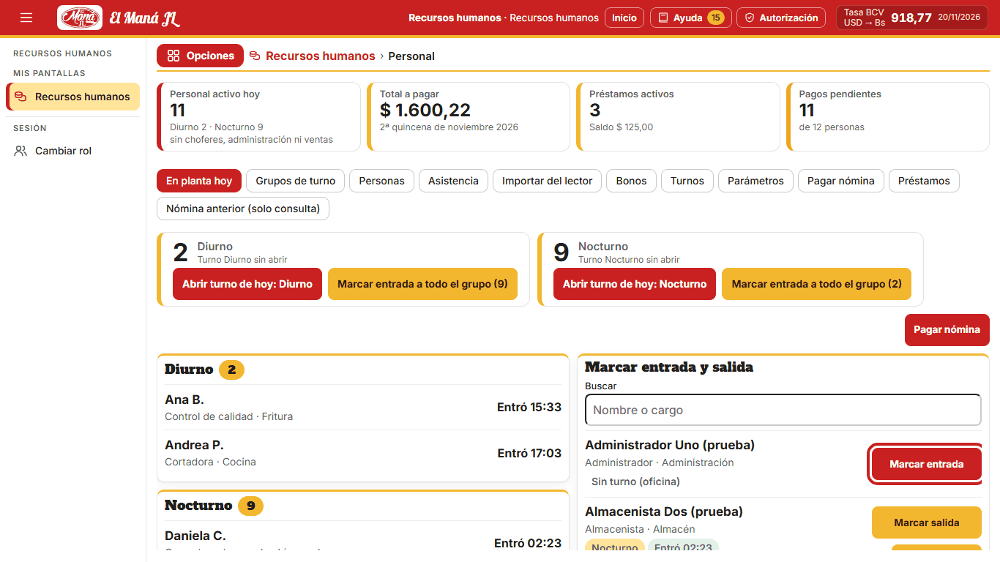

> Si el botón está apagado y dice «Falta el turno en Personal», mira «Si algo sale mal».

### Para marcar a todo el grupo de una vez

1. En el turno (Diurno o Nocturno) pulsa **Marcar entrada a todo el grupo**.
2. Si alguien faltó, pulsa **Quitar entrada** en su fila.

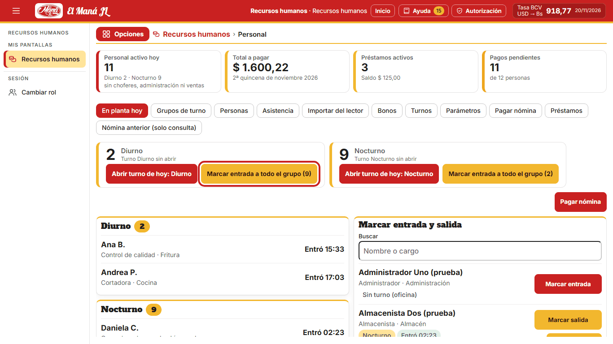

---

## Cómo armo los grupos de turno

1. Entra en **Grupos de turno**.
2. Elige quién integra el **Grupo 1**.
3. Elige quién integra el **Grupo 2**.
4. Elige qué turno tiene cada grupo esta semana (**Diurno** o **Nocturno**).

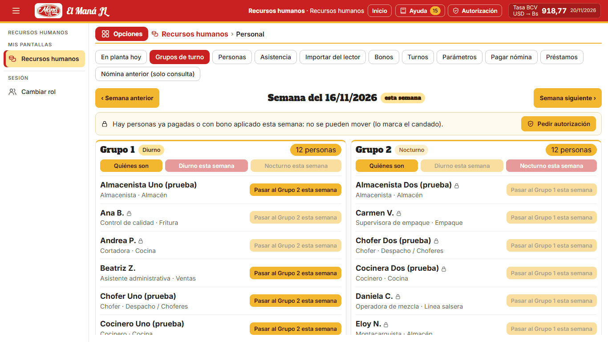

> Los turnos y los grupos son solo de planta (Producción y Logística). No incluyen a Administración, Ventas ni choferes.
> Producción solo puede iniciar si el grupo del turno tiene personal con entrada marcada.

---

## Cómo agrego a una persona

1. Entra en **Personas**.
2. En la tarjeta **Agregar persona**, escribe nombre y apellido.
3. Escribe la cédula.
4. Escribe el cargo.
5. Elige el puesto (Gerencia, Administración, Ventas, Recursos humanos, Producción o Logística) y su área.
6. Escribe la fecha de ingreso y el teléfono.
7. En **Se le paga por**, elige **Día** u **Hora**, y escribe la tarifa en $.
8. Si es de planta, elige el **Turno de trabajo** (**Diurno** o **Nocturno**).
9. Pulsa **Agregar persona**.

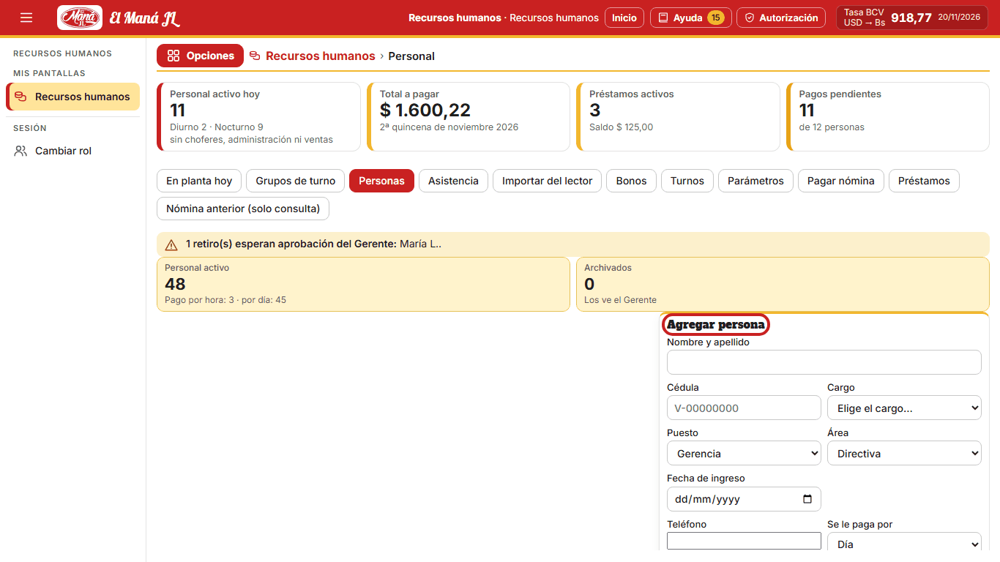

> Sin turno no se puede marcar la entrada. Si la persona maneja un vehículo, activa **Es chofer**.
> Si al abrir **En planta hoy** o **Personas** aparece **Revisa estas personas**, indica si son de Ventas o su área de Producción.

---

## Cómo cambio los horarios de los turnos

1. Entra en **Parámetros**.
2. En **Horario por turno**, elige cuándo entran y salen el **Diurno** y el **Nocturno**.
3. Elige desde qué día vale el cambio.
4. Guarda el cambio.

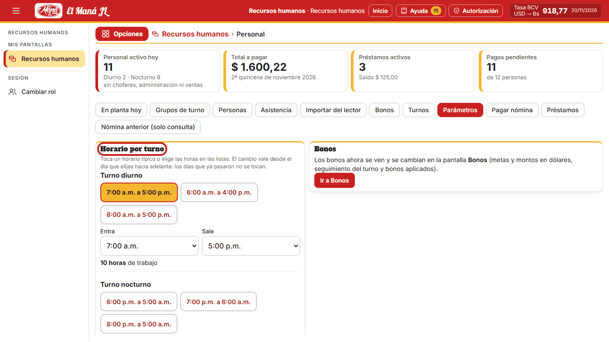

> Los días que ya pasaron no cambian. No se puede empezar en días ya pagados o con bono aplicado.
> Cada cambio queda en Auditoría y le llega un aviso a Gerencia.
> Las reglas de pago y el bono los cambia solo Gerencia.

---

## Cómo importo las marcas del lector de huellas

1. Entra en **Importar del lector**.
2. Sube el archivo del lector (Hikvision).
3. Revisa lo que el sistema entendió.
4. Asocia los códigos nuevos a su persona.
5. Resuelve lo dudoso.
6. Guarda.

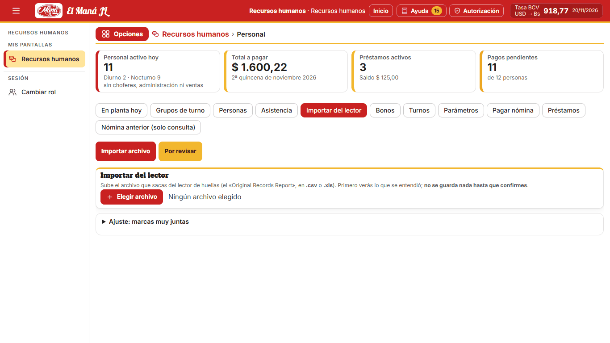

> La asistencia se llena sola con esas marcas.

---

## Cómo reviso la asistencia

1. Entra en **Asistencia**.
2. Cambia de quincena con **Anterior**, **Siguiente** y **Esta quincena**.
3. Mira quién vino y quién faltó.

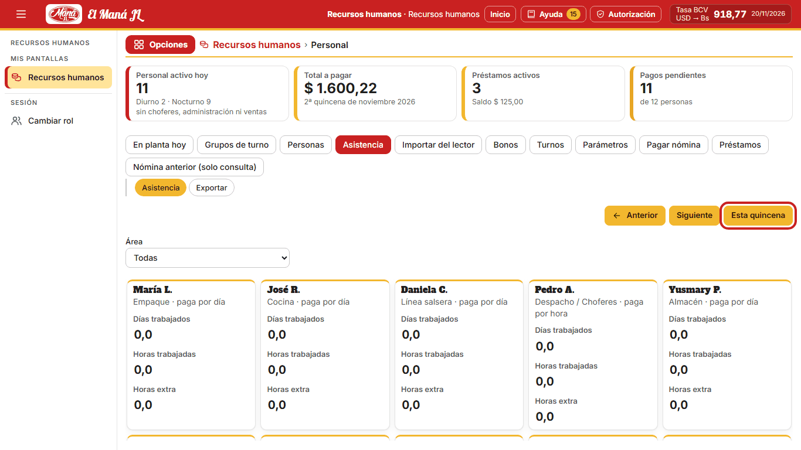

---

## Cómo veo los bonos y los turnos

1. Entra en **Bonos**.
2. En **Turno en vivo**, mira cuánto llevan y si califican.
3. Entra en **Turnos**.
4. Elige el día y el turno (**Diurno** o **Nocturno**).
5. Mira **Quiénes estuvieron**.

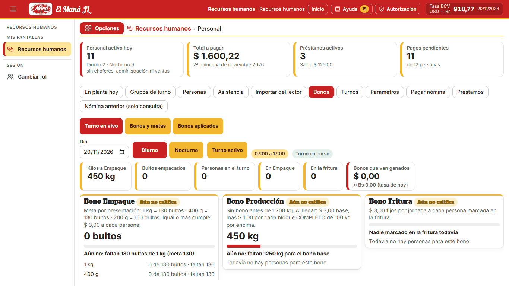

> Los bonos se aplican solos al cerrar el turno de Producción. Si algo no cuadra, avisa a Gerencia o a Administración (ellos pueden pulsar **Deshacer**).

---

## Cómo pago la nómina

1. Entra en **Pagar nómina**.
2. Elige **Semana**, **Quincena** o **Mes**.
3. Muévete con **Anterior**, **Siguiente** y **Hoy**.
4. Revisa la tabla: lo trabajado, horas extra, bonos, préstamo y total a pagar.

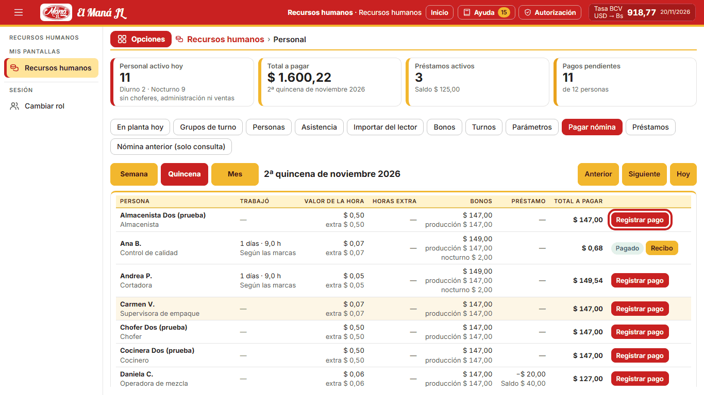

5. En la fila de la persona, pulsa **Registrar pago**.
6. Revisa base, extra, bonos y deducciones de ley.
7. Si tiene préstamo, marca **Descontar la cuota del préstamo** y escribe el **Monto a descontar ($)**.
8. Elige la fecha y la forma de pago (**Efectivo**, **Transferencia** o **Pago móvil**).
9. Pulsa **Confirmar pago**.

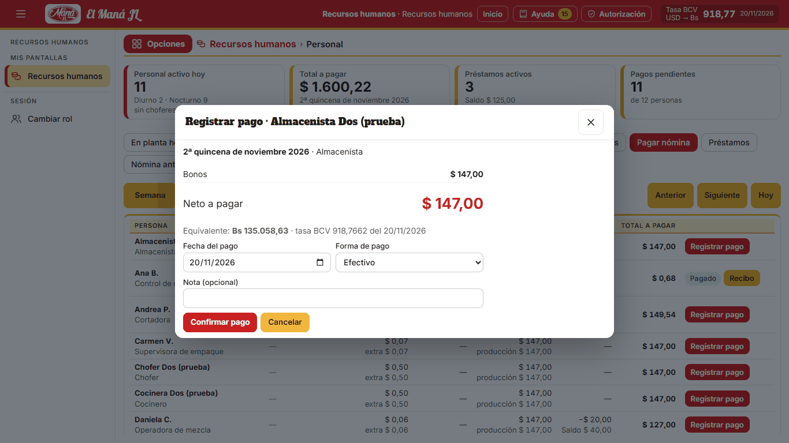

10. Cuando la fila diga **Pagado**, pulsa **Recibo** para imprimirlo o guardarlo en PDF.

> La nómina se calcula en dólares. Al pagar, el sistema muestra los bolívares a la tasa BCV del día de pago.

---

## Si algo sale mal

### El botón «Marcar entrada» está apagado

1. Mira el aviso en la fila: «Falta el turno en Personal».
2. Entra en **Personas**.
3. Abre a esa persona y elige su **Turno de trabajo**.
4. Vuelve a **En planta hoy** y marca la entrada.

### Marqué la entrada a alguien que faltó

1. En **En planta hoy**, busca a la persona.
2. Pulsa **Quitar entrada**.

### Producción no puede iniciar el turno

1. Revisa en **Grupos de turno** que el grupo del turno tenga personal.
2. Revisa en **En planta hoy** que esa gente tenga la entrada marcada.

### Necesito algo que no puedo cambiar

1. Pulsa **Autorización**, arriba.
2. Pulsa **Pedir autorización**.
3. En **¿Qué quieres cambiar?** elige lo que necesitas.
4. Escribe el **Motivo (obligatorio)**.
5. Pulsa **Enviar solicitud**.

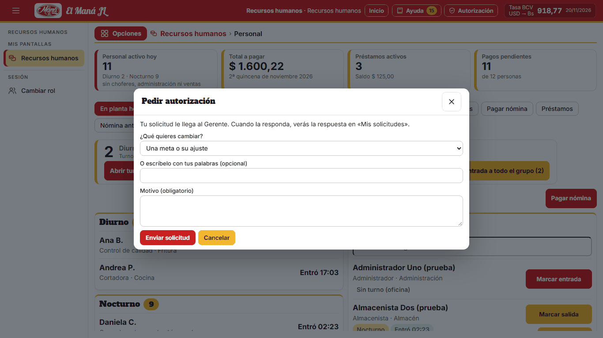

### Quiero saber qué respondieron

1. Abre **Mis solicitudes**.
2. Mira la respuesta de Gerencia.
