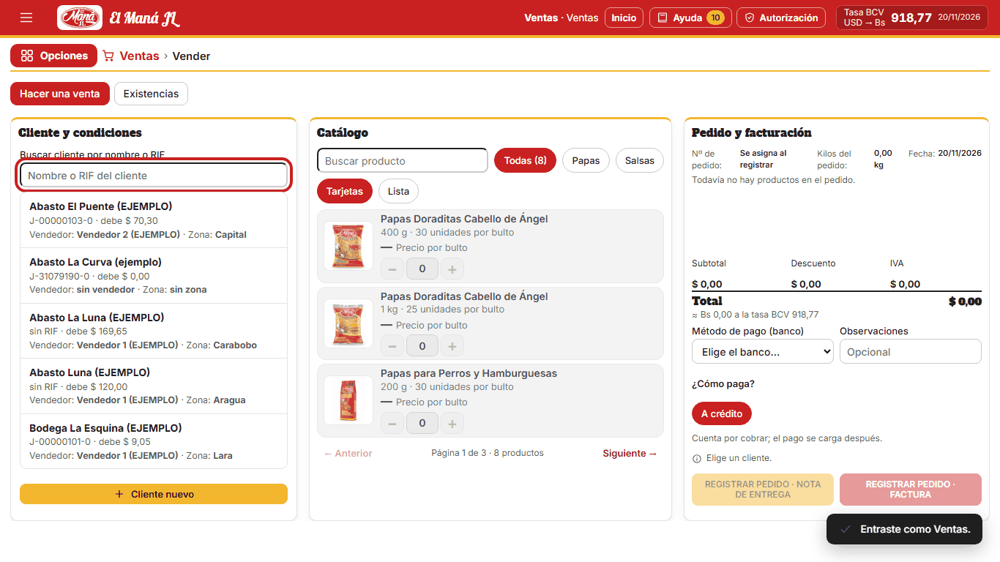
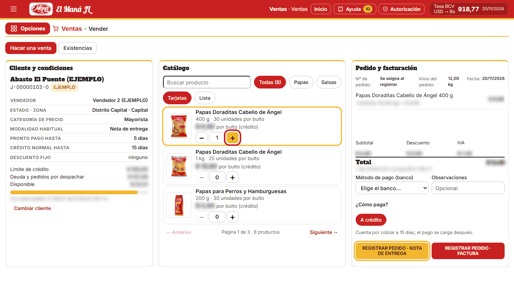
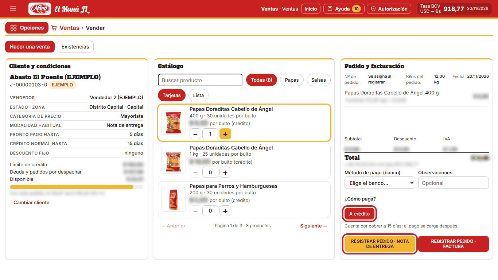
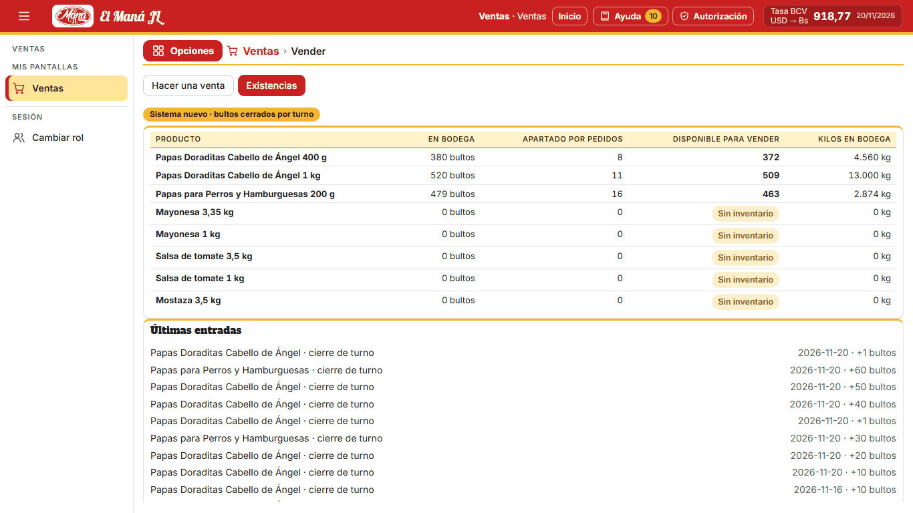
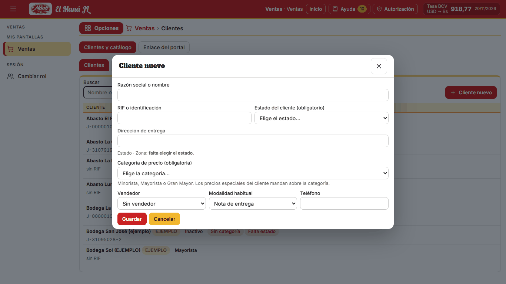
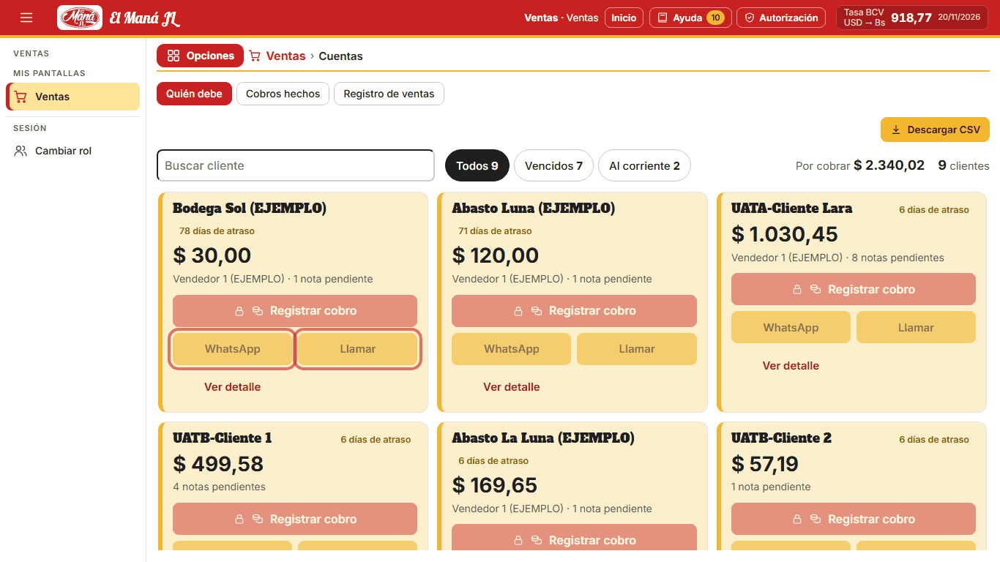
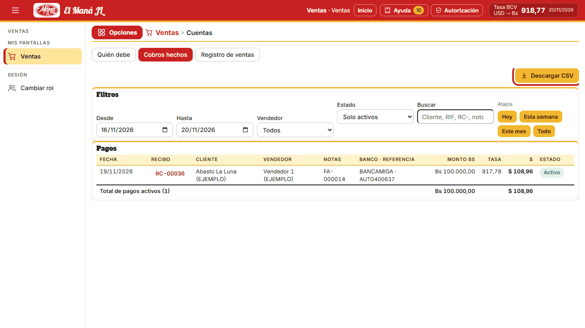
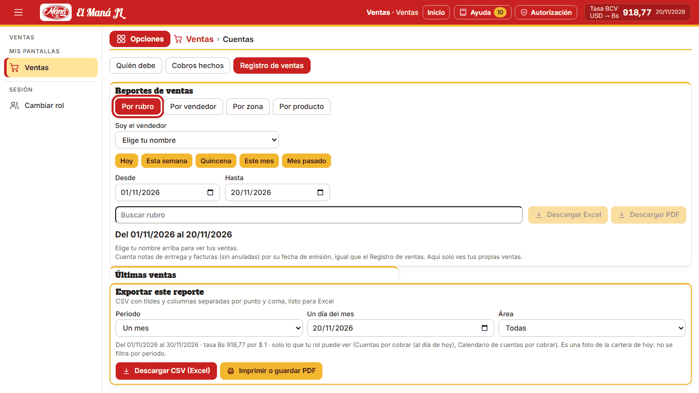
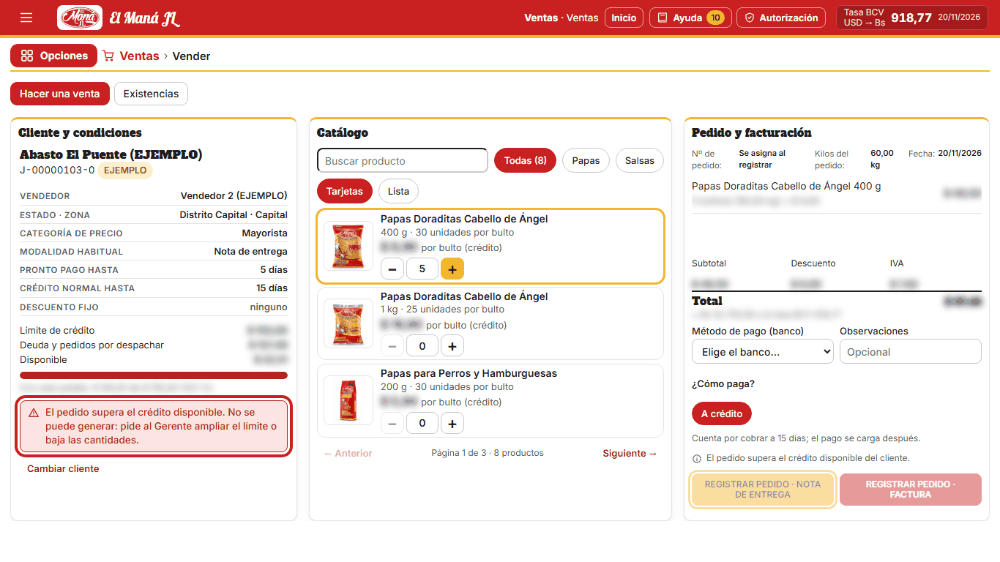
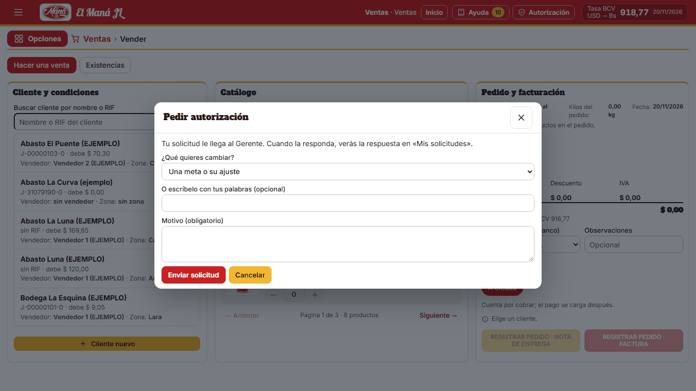

# Manual de Ventas

## Qué hace Ventas

Ventas atiende a los clientes: busca al cliente, arma el pedido, lo registra y entrega la nota de entrega o la factura. También mira cuánto producto hay disponible, quién debe y cómo van las ventas.

Ventas **no cambia precios**. Si un precio no está o está mal, se pide a Gerencia o Administración con «Pedir autorización».

## Mi día en 5 pasos

1. Entra al sistema y elige **Ventas**.
2. Mira **Existencias** para saber qué hay disponible.
3. Haz cada venta en **Hacer una venta**.
4. Mira **Quién debe** y recuérdale el pago a quien debe.
5. Al terminar, mira **Reportes de ventas** para ver cómo va el día.

---

## Cómo entro y elijo mi puesto

1. Abre el sistema.
2. Pulsa el botón **Ventas**.
3. Se abre la pantalla **Vender**.

> Si ves otro puesto arriba, pulsa **Cambiar rol** (a la izquierda) y elige **Ventas**.

---

## Cómo hago una venta

1. Pulsa **Opciones** y elige **Vender**. Se abre **Hacer una venta**.
2. En **Buscar cliente por nombre o RIF** escribe el nombre del cliente.
3. Toca al cliente en la lista.
4. En **Catálogo**, busca el producto (puedes tocar **Papas** o **Salsas**).
5. Pon los bultos del producto con **+** y **−**.

6. Mira el **Total** en **Pedido y facturación**.
7. En **¿Cómo paga?** deja marcado **A crédito**: la cuenta queda por cobrar y el pago lo registra Administración.

8. Pulsa **REGISTRAR PEDIDO · NOTA DE ENTREGA** (o **REGISTRAR PEDIDO · FACTURA** si el cliente pide factura).
9. Pulsa **Descargar PDF** y entrégale el documento al cliente.

> Si no está el cliente: mira «Cómo agrego un cliente nuevo».

---

## Cómo veo qué hay disponible

1. Pulsa **Opciones** y elige **Vender**.
2. Pulsa el botón **Existencias**.
3. Busca el producto: ves cuántos bultos hay.

> También en el **Catálogo** de cada venta aparece «Disponibles: N bultos» debajo de cada producto.

---

## Cómo agrego un cliente nuevo

1. Pulsa **Opciones** y elige **Clientes**.
2. Pulsa **Cliente nuevo**.
3. Escribe la razón social o el nombre.
4. Escribe el RIF o la identificación.
5. Elige el **estado** del cliente (es obligatorio: de ahí sale la zona de entrega).
6. Elige su categoría de precio: **Minorista**, **Mayorista** o **Gran Mayor**.
7. Escribe la dirección de entrega, el vendedor, la modalidad habitual y el teléfono.
8. Pulsa **Guardar**.

> También puedes pulsar **Cliente nuevo** dentro de **Hacer una venta**.

---

## Cómo veo quién debe

1. Pulsa **Opciones** y elige **Cuentas**.
2. Abre **Quién debe**.
3. Busca al cliente en la lista.
4. Pulsa **WhatsApp** o **Llamar** para recordarle el pago.

---

## Cómo veo los cobros hechos

1. Pulsa **Opciones** y elige **Cuentas**.
2. Abre **Cobros hechos**.
3. Mira la tabla de cobros.
4. Si la necesitas, pulsa **Descargar CSV**.

---

## Cómo veo los reportes de ventas

1. Pulsa **Opciones**, elige **Cuentas** y abre **Registro de ventas**.
2. Busca la tarjeta **Reportes de ventas**. En **Soy el vendedor** elige tu nombre.
3. Elige la pestaña: **Por rubro**, **Por vendedor**, **Por zona** o **Por producto**.
4. Elige el período: **Hoy**, **Esta semana**, **Quincena**, **Este mes** o **Mes pasado**.

---

## Si algo sale mal

### El sistema no me deja registrar la venta

Pasa si: no hay existencias, falta el precio o el cliente pasó su límite de crédito («El pedido supera el crédito disponible»).

1. Lee el aviso rojo que sale junto al cliente y junto a los botones.
2. Baja las cantidades o cambia de producto o de cliente.
3. Si hace falta más crédito, pídelo a Gerencia con «Pedir autorización».
4. Pulsa otra vez el botón de registrar.

### Falta un precio

1. Avisa a Gerencia o Administración.
2. O pulsa **Autorización** (arriba) y luego **Pedir autorización**.

### Necesito algo que no puedo cambiar

1. Pulsa **Autorización**, arriba.
2. Pulsa **Pedir autorización**.
3. En **¿Qué quieres cambiar?** elige lo que necesitas.
4. Escribe el **Motivo (obligatorio)**.
5. Pulsa **Enviar solicitud**.

### Quiero saber qué respondieron

1. Abre **Mis solicitudes**.
2. Mira la respuesta de Gerencia.
